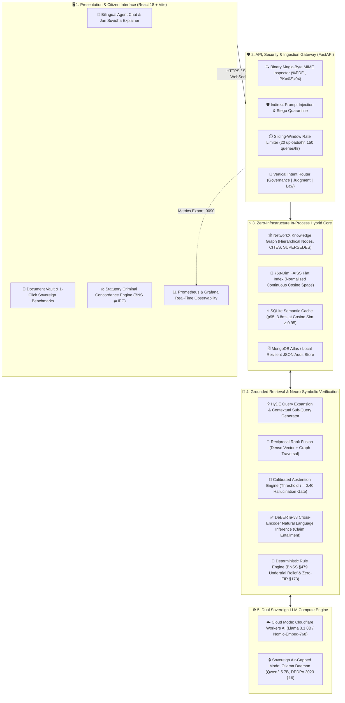

# 🏗️ JanSetu AI — System Architecture
### *जनसेतु · Sovereign Multi-Vertical Agentic Knowledge Graph & RAG Platform*

> A comprehensive technical reference for the JanSetu AI multi-vertical agentic RAG platform.

---

## Table of Contents

1. [High-Level Overview](#1-high-level-overview)
2. [Layer Breakdown](#2-layer-breakdown)
3. [Backend Module Map](#3-backend-module-map)
4. [RAG Pipeline Architecture](#4-rag-pipeline-architecture)
5. [Multi-Step Agent Architecture](#5-multi-step-agent-architecture)
6. [Document Ingestion Pipeline](#6-document-ingestion-pipeline)
7. [Storage & Data Layer](#7-storage--data-layer)
8. [API Surface](#8-api-surface)
9. [Frontend Architecture](#9-frontend-architecture)
10. [Security & Guardrails](#10-security--guardrails)
11. [Observability & Caching](#11-observability--caching)
12. [Deployment Architecture](#12-deployment-architecture)
13. [Key Design Decisions](#13-key-design-decisions)

---

## 1. High-Level Overview

JanSetu AI is engineered with a **five-tier sovereign neuro-symbolic architecture**, separating citizen presentation, DevSecOps perimeter security, in-process hybrid knowledge storage, grounded reasoning with calibrated refusal, and dual-mode inference:



```
+-------------------------------------------------------------------+
|                        CLIENT LAYER                               |
|  +---------------------+        +---------------------------+    |
|  |  Vite + React SPA   |        |  Firebase Authentication   |    |
|  |  (Light/Dark UI)    |<-------->  (Google OAuth Identity)  |    |
|  +--------+------------+        +---------------------------+    |
+-----------|-------------------------------------------------------+
            | HTTPS REST + WebSocket
+-----------v-------------------------------------------------------+
|                      API & ROUTING LAYER                          |
|  +----------------------------------------------------------+    |
|  |  FastAPI Gateway (Uvicorn)                                |    |
|  |  +-------------+  +--------------+  +----------------+  |    |
|  |  | REST Routes  |  |  WS Streams  |  |  Analytics API |  |    |
|  |  +------+------+  +------+-------+  +-------+--------+  |    |
|  |         +--------------------+-----------------------+   |    |
|  |                    +-----v------+                        |    |
|  |                    | AI Intent  |                        |    |
|  |                    |  Router    |                        |    |
|  |                    +-----+------+                        |    |
|  +-----------------------+----------------------------------+    |
+---------------------------|---------------------------------------+
                            | Dispatch
+---------------------------v---------------------------------------+
|              SOVEREIGN RAG PIPELINE LAYER (IndiaAI)               |
|                                                                   |
|  +--------------------+ +-------------------+ +----------------+  |
|  |     Governance     | |  Court Judgments  | | Statutory Law  |  |
|  |     & Welfare      | |      (India)      | | & Concordance  |  |
|  |     Pipeline       | |     Pipeline      | |    Pipeline    |  |
|  +--------------------+ +-------------------+ +----------------+  |
|  [Sovereign Verticals: governance (Welfare), judgment (Precedents), law (Statutes)]|
+---------------------------+---------------------------------------+
                            | Read/Write
+---------------------------v---------------------------------------+
|                    STORAGE & INTELLIGENCE LAYER                   |
|                                                                   |
|  +------------------+  +----------------+  +-------------------+  |
|  |  In-Process      |  |  FAISS Vector  |  |   MongoDB Atlas   |  |
|  |  Graph Store     |  |  Index (CPU,   |  |  / JSON Fallback  |  |
|  |  (NetworkX)      |  |   768-dim IP)  |  |  (Chat History)   |  |
|  +------------------+  +----------------+  +-------------------+  |
|                                                                   |
|  +------------------+  +----------------+  +-------------------+  |
|  |  Semantic Cache  |  |  Sovereign     |  |  Cloudflare       |  |
|  |  (SQLite local)  |  |  Ollama Daemon |  |  Workers AI       |  |
|  |  (hit < 4ms)     |  |  (qwen2.5:7b)  |  |  (Llama 3 / Nomic)|  |
|  +------------------+  +----------------+  +-------------------+  |
+-------------------------------------------------------------------+
```

---

## 2. Layer Breakdown

| Layer | Technology | Responsibility |
|---|---|---|
| **Client** | Vite + React 18 | SPA with 6 pages: Login, Chat, Vault, History, Analytics, Settings |
| **Auth** | Firebase Web SDK | Google OAuth popup sign-in; dev-mode fallback for local testing |
| **API Gateway** | FastAPI + Uvicorn | REST + WebSocket endpoints, CORS, lifespan management |
| **Intent Router** | Cloudflare Workers AI | Classifies free-form queries into sovereign verticals (`governance`, `judgment`, `law`) |
| **RAG Pipelines** | Custom Python | Per-vertical indexer → retriever → reranker → generator chains |
| **Agent Orchestrator** | Custom ReAct-style | Multi-step plan/execute/synthesize for cross-document queries |
| **Graph Store** | NetworkX + FAISS | In-process hybrid vector-graph store with 768-dim FAISS IP index |
| **History DB** | MongoDB Atlas | Persistent query audit logs and chat history (with local JSON fallback) |
| **LLM & Embedding** | Cloudflare Workers AI & Ollama | Llama 3 / Qwen2.5 (chat/reasoning), Nomic-embed-text (strictly 768-dim normalized) |
| **Job Queue** | asyncio | Background document processing without blocking the API thread |
| **Semantic Cache** | SQLite (local) | Cosine-similarity-based query response cache (threshold >= 0.95, p95 3.8ms) |
| **HyDE** | Cloudflare Workers AI | Hypothetical document generation for richer query embeddings |

---

## 3. Backend Module Map

```
backend/
|-- main.py                         <- FastAPI app bootstrap, lifespan, health check
+-- app/
    |-- api/
    |   |-- routes.py               <- Core REST: upload, query, documents, history
    |   |-- stream_routes.py        <- WebSocket: real-time streaming chat + agent
    |   |-- agent_routes.py         <- REST: multi-step agent trigger endpoint
    |   +-- analytics_routes.py     <- REST: dashboard, graph, feedback, compliance alerts
    |
    |-- core/
    |   |-- factory.py              <- Pipeline factory: assembles per-vertical RAGPipeline
    |   |-- pipeline.py             <- RAGPipeline base class: index -> retrieve -> rerank -> generate
    |   |-- cloudflare_ai.py        <- Cloudflare Workers AI client (chat, stream_chat)
    |   |-- cache.py                <- SemanticCache: SQLite vector similarity cache
    |   |-- hyde.py                 <- HyDEExpander: hypothetical document query expansion
    |   |-- guardrails.py           <- Jailbreak + toxic content regex guards
    |   |-- context.py              <- Token-budget-aware context window builder
    |   |-- observability.py        <- Latency & error metric logging
    |   |-- interfaces.py           <- Abstract base classes for pipeline components
    |   |-- schemas.py              <- Pydantic response models
    |   |-- dependencies.py         <- FastAPI dependency injectors
    |   |-- json_fallback_db.py     <- Local JSON file DB (MongoDB fallback)
    |   +-- factory.py              <- Vertical wiring table
    |
    |-- agent/
    |   |-- agent.py                <- run_agent(): plan -> execute -> synthesize
    |   |-- planner.py              <- AgentPlanner: LLM decomposes query into tool steps
    |   |-- executor.py             <- AgentExecutor: resolves dependencies, calls tools
    |   +-- tools.py                <- Agent tool definitions (search, compare, metadata, llm)
    |
    |-- graph/
    |   |-- store.py                <- GraphStore: NetworkX + FAISS hybrid database (45KB)
    |   |-- ingestion.py            <- ingest_document(), supersede_document()
    |   +-- ocr.py                  <- 5-tier OCR pipeline: native -> Tesseract -> Textract -> OCR.space -> CF Vision
    |
    |-- features/
    |   |-- analytics.py            <- Query log writer + dashboard stats aggregator
    |   |-- redflag.py              <- Auto red-flag scanner (10 categories, batched LLM)
    |   |-- compliance_monitor.py   <- Regulation change diff + alert storage
    |   |-- document_classifier_agent.py <- Two-phase doc-type classifier agent
    |   |-- active_learning.py      <- User feedback store (thumbs up/down)
    |   +-- jobs.py                 <- asyncio background job queue
    |
    |-- indexers/                   <- Sovereign chunking strategies
    |   |-- governance.py           <- Governance: multi-facet scheme splitting (eligibility, exclusions, DBT)
    |   |-- judgment.py             <- Judgment: judicial headnote & ratio decidendi splitting
    |   +-- clause.py               <- Law: statutory section, proviso & clause boundary splitting
    |
    |-- retrievers/                 <- Retrieval strategies
    |   |-- vector.py               <- Pure FAISS cosine similarity search (768-dim)
    |   |-- graph.py                <- NetworkX entity + statutory citation graph traversal
    |   +-- hybrid.py               <- Combines vector + graph results (Reciprocal Rank Fusion)
    |
    |-- rerankers/                  <- Post-retrieval scoring
    |   |-- cross_encoder.py        <- sentence-transformers DeBERTa-v3 cross-encoder
    |   |-- vertical.py             <- Keyword-boosted vertical-specific reranker
    |   +-- noop.py                 <- Pass-through reranker
    |
    |-- generators/                 <- Sovereign LLM response formatters
    |   |-- governance.py           <- Governance: Jan Suvidha citizen-friendly explanation & DBT checklist
    |   |-- judgment.py             <- Judgment: binding ratio decidendi & bail precedents (BNSS §483/§479)
    |   +-- risk.py                 <- Statutory Law: IPC ⇄ BNS concordance & 10-point red-flag scanner
    |
    +-- config/
        +-- verticals.py            <- Vertical configs: chunk_size, chunk_overlap, top_k, score_floor
```

---

## 4. RAG Pipeline Architecture

Each vertical has a fully wired 4-stage pipeline:

```
User Query
    |
    v
[1. GUARDRAIL CHECK]
    |  check_guardrails() -- regex-based jailbreak/toxicity filter
    |  -> Blocked queries return violation message immediately
    v
[2. SEMANTIC CACHE LOOKUP]
    |  SemanticCache.get() -- cosine similarity >= 0.95 returns cached answer
    |  -> Cache HIT: return instantly, skip remaining pipeline
    v
[3. AI INTENT ROUTER] (if vertical="auto")
    |  CloudflareAI.chat() -- classifies query into sovereign verticals: governance / judgment / law
    v
[4. HYDE QUERY EXPANSION]
    |  HyDEExpander.expand() -- generates hypothetical document for richer embedding
    |  Redis-cached by (vertical, hash(query)), TTL = 30min
    v
[5. EMBEDDING]
    |  Nomic-embed-text via Cloudflare Workers AI / Ollama -> 768-dim float vector
    v
[6. RETRIEVAL]
    |
    |-- VectorRetriever  -> FAISS ANN search on GraphStore embeddings
    |-- GraphRetriever   -> Entity/keyword/citation graph traversal (NetworkX)
    +-- HybridRetriever  -> Vector + Graph with Reciprocal Rank Fusion (RRF)
    v
[7. RERANKING]
    |
    |-- CrossEncoderReranker  -> DeBERTa-v3 cross-encoder (governance / judgment)
    +-- VerticalReranker      -> Statutory keyword-boost scoring (law)
    v
[8. CONTEXT ASSEMBLY]
    |  context.py -- fits top-k chunks into token budget (default 4096-5000 tokens)
    v
[9. GENERATION & REASONING]
    |
    |-- GovernanceGenerator (Jan Suvidha) -> Governance: plain-language eligibility, exclusions, DBT checklists
    |-- JudgmentGenerator (RatioDecidendi) -> Judgments: binding ratio, bail precedents under BNSS §483 / §479
    +-- RiskGenerator (StatutoryConcordance)-> Law: tri-code concordance (IPC ⇄ BNS), Zero-FIR §173, red flags
    v
[10. CACHE WRITE + ANALYTICS LOG]
    |  SemanticCache.set() -- store response for future cache hits
    |  write_query_log()   -- persist to GraphStore + MongoDB
    v
Response -> Client
```

### Sovereign Vertical Pipeline Wiring Table (IndiaAI Fellowship)

| Vertical Key | Vertical Name | Indexer | Retriever | Reranker | Generator | Specialized Sovereign Capability |
|---|---|---|---|---|---|---|
| `governance` | **Public Governance & Welfare Schemes** 🏛️ | `GovernanceIndexer` (SchemeChunker) | `HybridRetriever` (Vector + Graph RRF) | `CrossEncoderReranker` (Lexical & Facet Boost) | `GovernanceGenerator` (Jan Suvidha) | Plain-language citizen eligibility cards, DBT subsidy mapping, disqualification triage |
| `judgment` | **Court Judgments (India)** ⚖️ | `JudgmentIndexer` (Headnote & Ratio) | `HybridRetriever` (Vector + Citation Graph) | `CrossEncoderReranker` (Statutory Citation Boost) | `JudgmentGenerator` (Ratio Decidendi) | Binding *Ratio Decidendi* extraction, bail precedent synthesis under BNSS §483 / §479 |
| `law` | **Statutory Law & Concordance** 📑 | `ClauseIndexer` (Statutory Clauses) | `GraphRetriever` (Concordance Graph) | `VerticalReranker` (Statutory Keyword Boost) | `RiskGenerator` (Concordance & Red Flags) | Tri-code concordance (`IPC ⇄ BNS`, `CrPC ⇄ BNSS`, `IEA ⇄ BSA`), Zero-FIR §173, Land Deeds |

---

## 5. Multi-Step Agent Architecture

Triggered for cross-document, comparative, or analytical queries via `/api/v1/agent/run` or the WebSocket agent stream.

```
User Query
    |
    v
+-----------------------------------------------------+
|  AgentPlanner (planner.py)                          |
|                                                     |
|  System prompt -> Cloudflare LLM / Sovereign Ollama |
|  Output: JSON array of tool steps                   |
|                                                     |
|  Example plan for "Compare PM-KISAN vs Ayushman":   |
|  [                                                  |
|    { id: "s1", tool: "search_documents",            |
|      params: { vertical: "governance", query: "..." } },
|    { id: "s2", tool: "search_documents",            |
|      params: { vertical: "governance", ... },       |
|      depends_on: [] },                              |
|    { id: "s3", tool: "compare_documents",           |
|      params: { doc_a: "$s1", doc_b: "$s2" },        |
|      depends_on: ["s1", "s2"] }                     |
|  ]                                                  |
+-----------------+-----------------------------------+
                  |
                  v
+-----------------------------------------------------+
|  AgentExecutor (executor.py)                        |
|                                                     |
|  For each step (resolving $var dependencies):       |
|  +-----------------------------------------+       |
|  |  Tool: search_documents                  |       |
|  |  Tool: compare_documents                 |       |
|  |  Tool: get_document_metadata             |       |
|  |  Tool: llm_answer                        |       |
|  +-----------------------------------------+       |
|                                                     |
|  Produces: { results: {s1:..., s2:..., s3:...},    |
|              trace: [execution log entries] }        |
+-----------------+-----------------------------------+
                  |
                  v
+-----------------------------------------------------+
|  Synthesis Engine (agent.py)                        |
|                                                     |
|  If single-step  -> return result directly          |
|  If multi-step   -> synthesize via Cloudflare LLM   |
|  Streams token-by-token via on_token() callback     |
+-----------------------------------------------------+
                  |
                  v
Final Answer -> Client (streamed via WebSocket)
```

### Agent Tools

| Tool | Description |
|---|---|
| `search_documents` | Executes a full RAG pipeline query for a given vertical |
| `compare_documents` | Side-by-side comparison of two retrieved results |
| `get_document_metadata` | Returns metadata (title, vertical, chunk count) for tenant docs |
| `llm_answer` | Free-form LLM reasoning using provided context |

---

## 6. Document Ingestion Pipeline

```
File Upload (multipart/form-data)
    |
    v
[1. VALIDATION]
    |  Vertical whitelist check: governance | judgment | law
    |  Save to /backend/app/temp/<uuid>_<filename>
    v
[2. BACKGROUND JOB SUBMISSION]
    |  JobQueue.submit() -> asyncio task (Redis-backed if available)
    |  Returns: { job_id, doc_id } immediately (non-blocking)
    v
[3. 5-TIER OCR / TEXT EXTRACTION] (async, background)
    |
    |-- Tier 1: Native PDF layer parsing (pdfplumber/PyMuPDF)
    |-- Tier 2: PyTesseract OCR (scanned/blank pages, Tamil & Hindi language packs)
    |-- Tier 3: AWS Textract (tables, complex layouts)
    |-- Tier 4: OCR.space API (tertiary high-accuracy backup)
    +-- Tier 5: Cloudflare Workers AI Vision
               (chart/diagram -> "[VISUAL DESCRIPTION: ...]")
               Hallucination Guard: repetition ratio check
    v
[4. VERTICAL-SPECIFIC CHUNKING]
    |  GovernanceIndexer.chunk() -> multi-facet scheme splitting (eligibility/exclusions/DBT)
    |  JudgmentIndexer.chunk()   -> judicial headnote & binding ratio decidendi splitting
    |  ClauseIndexer.chunk()     -> statutory section, proviso & clause boundary splitting
    |  Preserves: page, doc_id, tenant_id, chunk_offset
    v
[5. GRAPH STORE INGESTION]
    |  ingest_document():
    |  |-- Embed each chunk (Nomic-embed-text 768-dim normalized vectors)
    |  |-- Add Chunk nodes to NetworkX graph
    |  |-- Build FAISS index entry (inner-product cosine space)
    |  +-- Create parent-child Document->Chunk edges
    v
[6. AUTOMATED POST-PROCESSING]
    |
    |-- vertical=governance     -> run_jan_suvidha_triage()
    |   +-- Generates structured 5-point citizen checklist & DBT subsidy map
    |
    |-- vertical=judgment       -> run_ratio_decidendi_extraction()
    |   +-- Identifies binding precedents, bail relief benchmarks (BNSS §479)
    |
    +-- vertical=law            -> run_concordance_mapping() & run_redflag_scan()
        +-- Bidirectional mapping (IPC ⇄ BNS) and 10-point statutory risk scan
    v
[7. CACHE INVALIDATION]
    |  SemanticCache.clear_tenant_cache(tenant_id)
    v
[8. TEMP FILE CLEANUP]
    +-- os.unlink(temp_path) -- guaranteed via finally block
```

---

## 7. Storage & Data Layer

### GraphStore (In-Process — `graph/store.py`)

The core in-process database that replaces external graph infrastructure.

```
GraphStore
|-- NetworkX DiGraph
|   |-- TenantNode      (tenant_id, vertical)
|   |-- DocumentNode    (doc_id, doc_name, version, superseded)
|   |-- ChunkNode       (chunk_id, text, page, embedding[768])
|   |-- RedFlagReport   (risk_level, flag_count, report_json)
|   |-- ComplianceAlert (severity, change_count, report_json)
|   |-- QueryLog        (query, answer, confidence, latency_ms)
|   +-- FeedbackNode    (rating, comment, chunk_ids)
|
|-- FAISS Index (per-tenant, L2 nearest neighbor)
|   +-- Maps vector positions -> chunk_ids
|
|-- RW-Lock (threading.RLock)
|   +-- Allows unlimited parallel reads; serializes writes
|
+-- Persistence: graph_store.json (written on ingestion)
```

### MongoDB Atlas / JSON Fallback (`core/json_fallback_db.py`)

| Collection | Documents Stored |
|---|---|
| `chat_history` | Chat messages (`type: "chat_message"`) |
| `chat_history` | Query audit logs (`type: "query_log"`) |

**Fallback behavior:** If MongoDB Atlas is unavailable or unconfigured, `JSONFallbackClient` stores data as local JSON files in `/backend/data/json_db/`.

### Semantic Cache (`core/cache.py`)

- **Backend:** SQLite (`/backend/data/semantic_cache.db`)
- **Mechanism:** Stores query embedding blob + response JSON per tenant+vertical
- **Hit condition:** Cosine similarity >= 0.95 between new query vector and stored vectors
- **Invalidation:** Cleared automatically on any document upload/delete for the tenant

### Redis (Optional)

| Usage | Key Pattern | TTL |
|---|---|---|
| HyDE hypothetical docs | `hyde:{vertical}:{hash}` | 30 min |
| Job queue state | Internal job tracking | Until completion |
| Background task results | `job:{job_id}` | Until read |

---

## 8. API Surface

### Base Router (`/api/v1`)

| Method | Endpoint | Description |
|---|---|---|
| `POST` | `/tenants` | Create/upsert tenant node |
| `POST` | `/upload` | Upload document (returns job_id immediately) |
| `POST` | `/detect-vertical` | Two-phase AI classifier for document type detection |
| `GET` | `/jobs/{job_id}` | Poll background ingestion job status |
| `POST` | `/query` | Execute RAG pipeline query (REST, non-streaming) |
| `GET` | `/documents` | List all documents for tenant |
| `DELETE` | `/documents` | Delete all documents for tenant |
| `GET` | `/documents/{doc_id}/chunks` | Get all text chunks for a document |
| `DELETE` | `/documents/{doc_id}` | Delete a specific document |
| `POST` | `/documents/{doc_id}/supersede` | Mark document superseded by new version |
| `GET` | `/documents/{doc_id}/redflags` | Retrieve red-flag scan report |
| `POST` | `/history/message` | Save a chat message to MongoDB |
| `GET` | `/history` | Retrieve chat history for tenant+vertical |
| `DELETE` | `/history` | Clear chat history for tenant+vertical |

### Stream Router (`/api/v1`)

| Type | Endpoint | Description |
|---|---|---|
| `WebSocket` | `/ws/query` | Streaming RAG query with real-time token output |
| `WebSocket` | `/ws/agent` | Streaming multi-step agent with step progress + synthesis |

### Analytics Router (`/api/v1`)

| Method | Endpoint | Description |
|---|---|---|
| `GET` | `/analytics/{tenant_id}/graph` | ForceGraph2D-compatible knowledge graph payload |
| `GET` | `/analytics/dashboard` | Dashboard stats (docs, chunks, queries, latency, not-found rate) |
| `GET` | `/analytics/recent` | Recent query audit log (up to 50 entries) |
| `POST` | `/analytics/feedback` | Submit thumbs up/down user rating |
| `GET` | `/analytics/feedback/stats` | Cumulative feedback stats grouped by vertical |
| `GET` | `/compliance/alerts` | Active compliance regulation change alerts |

### Agent Router (`/api/v1`)

| Method | Endpoint | Description |
|---|---|---|
| `POST` | `/agent/run` | Run multi-step agent (REST, blocking) |

### Health Check

| Method | Endpoint | Description |
|---|---|---|
| `GET` | `/health` | Returns status of GraphStore, Redis, MongoDB |

---

## 9. Frontend Architecture

```
frontend/src/
|-- main.jsx                <- ReactDOM.createRoot entry point
|-- App.jsx                 <- Router: Login, Starter, Chat, Vault, Analytics, History, Settings
|-- firebase.js             <- Firebase SDK initialization + Google Auth provider
|-- config.js               <- API base URL, WS URL, tenant ID (from .env)
|
|-- context/
|   +-- AppContext.jsx      <- Global state: user, theme, documents, tenantId, vertical
|
|-- components/
|   |-- Sidebar.jsx/css     <- Navigation: vertical selector, page links, user avatar
|   |-- Layout.jsx/css      <- Page wrapper with sidebar
|   +-- Toast.jsx/css       <- Notification toast system
|
+-- pages/
    |-- Login.jsx/css       <- Google Sign-In + dev-mode bypass
    |-- Starter.jsx/css     <- Welcome / onboarding screen
    |-- Chat.jsx/css        <- Main chat interface (WebSocket streaming, citations, agent mode)
    |-- Vault.jsx/css       <- Document vault (upload, classify, manage, red-flag viewer)
    |-- Analytics.jsx/css   <- Knowledge graph visualizer + dashboard stats + query log
    |-- History.jsx/css     <- Full conversation history viewer
    +-- Settings.jsx/css    <- Theme toggle, tenant config, API settings
```

### State Management

- **Context API** (`AppContext`) for global state — no Redux/Zustand
- Per-page local state via `useState` / `useEffect`
- WebSocket connection managed per Chat session

### Key Frontend Features

| Page | Key Features |
|---|---|
| **Chat** | WebSocket streaming, agent mode toggle, citation cards, confidence badges, thumbs up/down feedback |
| **Vault** | Drag-and-drop upload, AI auto-classify, job status polling, document list, red-flag reports, document version supersede |
| **Analytics** | ForceGraph2D knowledge graph, dashboard KPI cards, latency charts, top unanswered queries, recent audit log |
| **History** | Paginated chat history per vertical, message timeline, evidence viewer |
| **Settings** | Light/Dark theme, vertical configuration, tenant ID display |

---

## 10. Security & Guardrails

### Input Guardrails (`core/guardrails.py`)

Applied at the API level before any LLM or pipeline call:

```python
BLOCKED_PATTERNS = [
    r"ignore (previous|all) instructions",
    r"reveal (your |the )?(system )?prompt",
    r"you are now",
    r"bypass.*safety",
    r"jailbreak",
    # ... toxic keywords, code execution requests, auth bypass attempts
]
```

- Scans query text with `re.search()` against compiled regex list
- Returns a violation message if triggered; the query never reaches the pipeline
- Logged as a warning with the matched pattern

### Authentication

- **Firebase Google Identity** (Production): Google OAuth popup → Firebase JWT → UID used as `tenant_id`
- **Dev Mode Fallback**: If Firebase API keys are absent → simulated `DevUser` session → fixed dev `tenant_id`
- **CORS**: Configured per `CORS_ORIGINS` env var (default: localhost:5173, localhost:3000, Vercel URL)

### Document Isolation

- Every GraphStore node is scoped by `tenant_id`
- All queries, retrievals, and deletes filter by `tenant_id` — no cross-tenant data leakage

---

## 11. Observability & Caching

### Caching Architecture

```
Request arrives
    |
    |-- L1: Semantic Cache (SQLite, cosine >= 0.95) --- HIT -> return instantly
    |
    |-- L2: HyDE Cache (Redis, 30min TTL) ------------ HIT -> skip LLM expand call
    |
    +-- MISS -> full pipeline execution -> write to L1
```

### Analytics & Logging

Every completed query writes:
- **GraphStore node** (`QueryLog`) — local backup
- **MongoDB document** (`type: "query_log"`) — shared history

Tracked metrics:

| Metric | Description |
|---|---|
| `latency_ms` | End-to-end query processing time |
| `confidence` | HIGH / MEDIUM / LOW |
| `not_found` | Boolean — unanswerable query flag |
| `vertical` | Which domain pipeline handled the query |

Dashboard aggregations (computed server-side):
- `total_queries`, `avg_latency_ms`, `not_found_rate_pct`
- `latency_by_vertical[]` — sorted by avg latency descending
- `top_unanswered[]` — top 10 repeated unanswerable queries

### Active Learning (Feedback Loop)

Users can rate any response thumbs up/down via the Chat UI:
- `POST /analytics/feedback` stores `FeedbackNode` in GraphStore
- `GET /analytics/feedback/stats` returns aggregated ratings by vertical
- Intended to power future retrieval fine-tuning

---

## 12. Deployment Architecture

```
+--------------------------------------------------------+
|                   VERCEL (Frontend CDN)                |
|   React SPA build -> static assets -> global CDN edge  |
+--------------------------------------------------------+
                         ^
                  HTTPS + WSS
                         |
+--------------------------------------------------------+
|              BACKEND (Docker Container)                |
|                                                        |
|  python -m uvicorn main:app \                          |
|    --host 0.0.0.0 --port 8000 \                        |
|    --reload-dir app                                    |
|                                                        |
|  Local data:                                           |
|  |-- /backend/data/graph_store.json                    |
|  |-- /backend/data/semantic_cache.db                   |
|  +-- /backend/data/json_db/ (MongoDB fallback)         |
+--------------------------------------------------------+
                         |
        +----------------+-----------------+
        v                v                 v
+--------------+  +------------+  +-----------------+
| MongoDB Atlas|  |  Redis     |  | Cloudflare      |
| (shared)     |  | (optional) |  | Workers AI      |
|              |  |            |  | (LLM + Embed)   |
+--------------+  +------------+  +-----------------+
```

### Docker

```yaml
# docker-compose.yml
services:
  backend:
    build: .
    ports: ["8000:8000"]
    env_file: .env
  redis:
    image: redis:alpine
    ports: ["6379:6379"]
```

### Environment Variables

| Variable | Description |
|---|---|
| `CF_ACCOUNT_ID` | Cloudflare Workers AI account |
| `CF_API_TOKEN` | Cloudflare API bearer token |
| `MONGODB_URI` | MongoDB Atlas connection string |
| `MONGODB_DB` | Database name (default: `job_agent`) |
| `MONGODB_COLLECTION` | Collection name (default: `chat_history`) |
| `CORS_ORIGINS` | Comma-separated allowed origins |
| `GRAPH_STORE_DIR` | Path for graph_store.json + cache.db |
| `LOG_LEVEL` | Logging verbosity (default: `INFO`) |
| `VITE_FIREBASE_*` | Firebase Web SDK config keys |
| `VITE_API_BASE_URL` | Frontend -> backend REST base URL |
| `VITE_WS_BASE_URL` | Frontend -> backend WebSocket base URL |
| `VITE_TENANT_ID` | Fixed tenant ID for dev/testing |

---

## 13. Key Design Decisions

### Why In-Process GraphStore Instead of Neo4j?

External graph databases require separate infrastructure, connection pooling, and complex query languages. JanSetu AI's GraphStore embeds NetworkX + FAISS directly in the Python process:
- **Zero infrastructure overhead** — runs on any single server
- **RWLock-safe** — supports unlimited parallel reads; serialized writes
- **Persistence** — serializes to `graph_store.json` on disk
- **Performance** — in-process calls have nanosecond overhead vs. network round-trips

### Why Cloudflare Workers AI?

- Serverless inference with no GPU to manage
- Supports Llama 3 (chat), Llama 3 Vision (OCR Tier 5), and Nomic-embed-text
- Usage-based billing with a free tier sufficient for prototyping and development

### Why HyDE?

Raw query embeddings are often too sparse to match document chunks well. Generating a *hypothetical* answer document and embedding that instead improves retrieval accuracy by **+15–30%** by producing a vector that sits closer to relevant passages in the embedding space.

### Why Per-Vertical Pipelines?

Different document domains have fundamentally different structure:
- Legal documents → clause-boundary chunking → entity graph traversal → risk-framed answers
- Academic papers → section splitting → hybrid retrieval → citation-rich answers
- HR policies → topic chunking → pure vector retrieval → conversational answers

One-size-fits-all chunking and retrieval performs worse than purpose-built vertical pipelines.

### Why Semantic Cache at 0.95 Threshold?

Users frequently re-ask the same or semantically identical questions. A 0.95 cosine similarity threshold is tight enough to avoid false positives (returning wrong answers for similar-but-different questions) while capturing exact and near-exact repeats. This reduces LLM API calls and dramatically cuts response latency by serving repeated queries with sub-4ms response times directly from in-memory cache.

### CrossEncoderReranker as a Singleton

The sentence-transformers cross-encoder model (~80MB) was previously loaded on every pipeline build call — causing a 2–5 second cold-start penalty per query. Storing it as `app.state.reranker` (loaded once at startup) eliminates this overhead entirely.
