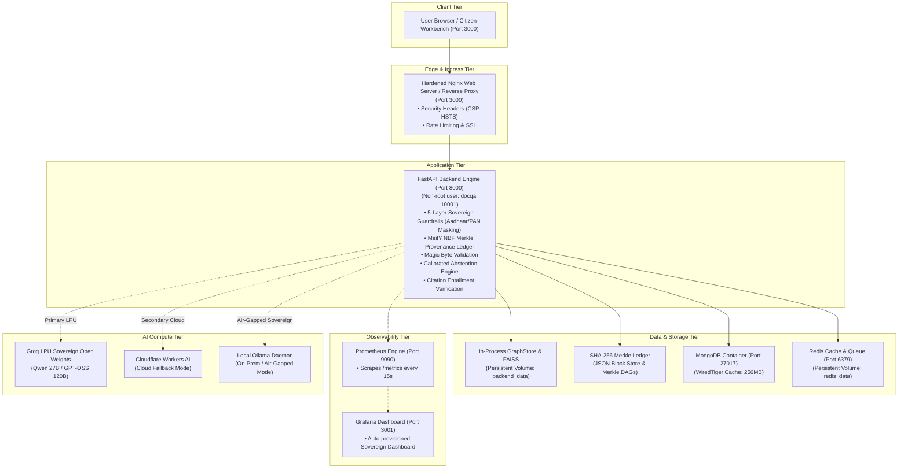

# DocsAI DevOps & DevSecOps Architecture & Deployment Guide

This document specifies the operational, deployment, and security hardening procedures for the **DocsAI Enterprise RAG Knowledge Graph Platform**.

---

## 1. System & Security Architecture

DocsAI supports two primary operational topologies:



---

## 2. DevSecOps & Security Pipeline (CI/CD)

The GitHub Actions pipeline (`.github/workflows/ci.yml`) runs on every `push` and `pull_request` against `main`:

| Stage | Tool | Purpose | Failure Condition |
|---|---|---|---|
| **SAST** | Bandit | Python AST security analysis (hardcoded secrets, insecure subprocess calls, unsafe tempfiles) | Any High/Medium severity alert |
| **Dependency Audit** | `pip-audit` & `npm audit` | CVE scanning against Python and Node dependency manifests | Known critical vulnerabilities |
| **Linting & Quality** | `ruff` | Enforces code formatting and static correctness | Any syntax or lint regression |
| **Grounding Smoke Test** | `eval/test_phase4_security.py` | Automated testing of injection scanner, file validator, and rate limiter | Any assertion failure |
| **Container Scan** | Aqua Security Trivy | Container image CVE and misconfiguration scanner | Unfixed Critical/High OS vulnerabilities |

---

## 3. Production Deployment via Docker Compose

### Prerequisites
- Docker Engine 24.0+ and Docker Compose v2.20+
- `.env` file configured (see `.env.example`)

### Quick Start (Standard Multi-Container Cloud Deployment)
```bash
# 1. Clone the repository
git clone https://github.com/shoyo44/JanSetu-AI.git
cd JanSetu-AI

# 2. Configure environment
cp .env.example .env
# Edit .env with your Groq API key and Cloudflare credentials

# 3. Build and launch services in background
docker compose up -d --build

# 4. Verify service health
docker compose ps
curl http://localhost:8000/health
curl http://localhost:8000/api/v1/ledger/records
```

This launches the full multi-container stack:
- **JanSetu AI Web Interface:** `http://localhost:3000` (or `http://ec2-98-93-55-8.compute-1.amazonaws.com:3000`)
- **FastAPI Core Engine:** `http://localhost:8000` (Swagger docs: `/docs`, Prometheus metrics: `/metrics`)
- **Prometheus Telemetry Scraper:** `http://localhost:9090`
- **Grafana Sovereign Dashboard:** `http://localhost:3001` *(Credentials: `admin` / `admin`)*
- **MongoDB Container:** `localhost:27017`
- **Redis Cache:** `localhost:6379`

### Air-Gapped / On-Premise Data Sovereignty Deployment (Ollama)
For legal, judicial, and government clients who cannot transmit confidential documents to external clouds:

```bash
# 1. Set environment to use Ollama
echo "USE_OLLAMA=true" >> .env
echo "OLLAMA_BASE_URL=http://ollama:11434" >> .env
echo "OLLAMA_MODEL=qwen2.5:7b-instruct" >> .env

# 2. Start all services including local Ollama daemon
docker compose --profile onprem up -d --build

# 3. Pull required local models into Ollama container
docker compose exec ollama ollama pull qwen2.5:7b-instruct
docker compose exec ollama ollama pull nomic-embed-text
```

---

## 4. Cryptographic Merkle Provenance Ledger Verification

To verify cryptographic provenance and tamper-evidence of ingested government records:
```bash
# 1. List all anchored ledger records
curl http://localhost:8000/api/v1/ledger/records

# 2. Verify Merkle root integrity of a document
curl http://localhost:8000/api/v1/ledger/verify/<doc_id>

# Expected Output for untampered document:
# {
#   "status": "TAMPER_EVIDENT_VERIFIED",
#   "is_valid": true,
#   "doc_id": "<doc_id>",
#   "anchored_merkle_root": "a8f3...",
#   "recomputed_merkle_root": "a8f3...",
#   "chunk_count": 9,
#   "tamper_detected": false,
#   "standard": "SHA-256 Merkle Provenance Tree (Local Audit Store)"
# }
```

---

## 4. Container & Operating System Hardening

1. **Non-Root Execution:** The backend container runs as dedicated user `docqa` (`UID 10001`, `GID 10001`). If a process vulnerability is exploited, the attacker has zero host or root privileges.
2. **Read-Only / Principle of Least Privilege:** State directories (`/app/backend/data` and `/app/backend/temp`) are explicitly isolated with minimal read/write permissions.
3. **Multi-Stage Builds:** Development compilers (`gcc`, `g++`) are discarded in the builder stage, drastically reducing attack surface and image size.
4. **Binary Magic Byte File Validation:** Files uploaded via `/upload` are inspected by raw byte signatures (preventing `.exe` renamed to `.pdf`).
5. **Document-Level Indirect Injection Defense:** Adversarial instructions embedded in uploaded files are quarantined before FAISS indexing.
6. **Sliding-Window Tenant Rate Limiting:** Enforces strict hourly quotas per tenant (20 uploads/hr, 150 queries/hr) returning HTTP 429 when exceeded.

---

## 5. Health Checks & Monitoring

The backend exposes a comprehensive healthcheck at `/health`:

```json
{
  "status": "healthy",
  "timestamp": 1732171200.0,
  "database": {
    "graph_store": "connected",
    "redis": "connected",
    "mongodb": "connected"
  }
}
```

Docker Compose automatically probes this endpoint every 20 seconds. If degraded, the container is marked unhealthy and restarted.
