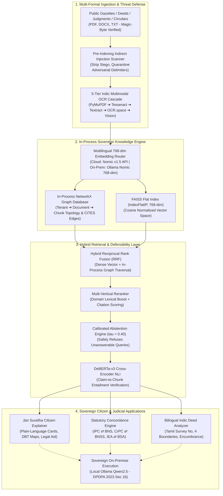

# IndiaAI Fellowship Project Proposal Dossier

**Project Title:** JanSetu AI Sovereign MultiVertical Agentic Knowledge Graph RAG Platform for Public Governance and Citizen Welfare  
**Applicant Name:** Dhanush S (Enrolment No: 99230041087, CGPA: 8.93, 7th Sem / 4th Year B.Tech CSE)  
**Faculty Guide / Supervisor:** Dr. Vijay M, Associate Professor, Department of Computer Science and Engineering, Kalasalingam Academy of Research and Education  
**Alternative Guide:** Dr. Gurusigaamani M, Associate Professor, Department of Computer Science and Engineering  
**Head of Department:** Dr. R. Raja Subramanian, Associate Professor & HoD, Department of Computer Science and Engineering  
**Institution:** Department of Computer Science and Engineering, Kalasalingam Academy of Research and Education (Deemed to be University), Anand Nagar, Krishnankoil, Tamil Nadu - 626126  
**Primary Domain (Portal Choice):** Governance *(Cross-cutting with Law and Justice)*  
**Repository:** [github.com/shoyo44/JanSetu-AI](https://github.com/shoyo44/JanSetu-AI)  
**Target Fellowship:** IndiaAI Fellowship 2026–27 (Undergraduate track, Ministry of Electronics and Information Technology, MeitY)  

---

## 1. Executive Summary & Abstract

### Official Portal Submission Text (440 Words — Form Submission Ready)

Across India, many citizens miss out on public welfare schemes and legal protections simply because administrative language is complex and official information is difficult to find. A smallholder farmer struggles to interpret PM-KISAN exclusion clauses. A student faces an arbitrary ten-month rental deposit demand, even though the Model Tenancy Act caps residential deposits at two months in states that have adopted it. Many undertrial prisoners may qualify for bail consideration under Section 479 of the Bharatiya Nagarik Suraksha Sanhita (BNSS), but uneven legal awareness and paperwork keep them detained.

As an undergraduate computer science researcher at Kalasalingam Academy of Research and Education, I developed JanSetu AI (जनसेतु)—a zero-infrastructure document intelligence system for public governance, statutory law, and citizen assistance. Because commercial chatbots can invent answers or send citizen data to external servers, JanSetu AI emphasizes local data residency and verifiable evidence. It couples an in-process knowledge graph (NetworkX) with dense vector search (FAISS), fused through Reciprocal Rank Fusion. To prevent false answers, an abstention mechanism (initial similarity threshold τ = 0.40, selected on a 20-query development split and to be recalibrated on the full benchmark) refuses to answer whenever documents lack supporting facts. Retrieved citations are checked using a cross-encoder Natural Language Inference model (English-primary). The platform includes a deterministic concordance engine (IPC–BNS, CrPC–BNSS, IEA–BSA), an 8-rule engine assessing BNSS §479 release eligibility for lawyer review, regex masking for Aadhaar and PAN numbers, and an internal SHA-256 Merkle provenance ledger (a local hash tree, not an implementation of MeitY's National Blockchain Framework).

For grassroots access, the platform generates simplified Jan Suvidha welfare cards, supports browser-assisted Indic voice queries, and includes an OCR pipeline to extract key clauses from scanned Tamil land deeds (கிரையப் பத்திரம்). The public web demo relies on external cloud inference and should not receive personal data; an air-gapped on-premise profile using local Ollama models is provided for institutional data residency.

The prototype currently has two tiers of evidence. First, all deterministic test suites—including live backend integration tests, 30 statutory concordance lookups, 8 BNSS §479 rule checks, 10 prompt-injection defenses, 25 PII-masking checks, and a Merkle tamper test—pass cleanly. Second, the repository contains a curated 150-query multilingual question set (120 answerable, 30 unanswerable; English, Hindi, and Tamil) mapped to ground-truth legal clauses. Formally measured retrieval, refusal, and entailment benchmarks across naive, graph, cloud, and on-premise configurations—along with independent dual annotation—are not yet complete and form the primary initial deliverables of this fellowship.

Under the IndiaAI Fellowship, I will complete multi-annotator benchmark validation, publish the open dataset and concordance maps to AIKosh, extend land deed extraction to Hindi and Telugu with OCR error reporting, and prepare lightweight edge packages for legal-aid kiosks.

Live cloud prototype (plain HTTP; do not enter personal data): http://ec2-98-93-55-8.compute-1.amazonaws.com:3000
Code repository: https://github.com/shoyo44/JanSetu-AI

---

### Extended Technical Abstract & System Summary

India faces an immense dual bottleneck at the intersection of public administration and justice delivery: over 4.4–5.1 crore pending court cases (source: National Judicial Data Grid, NJDG 2024), alongside a severe information asymmetry preventing common citizens from claiming statutory rights and direct welfare entitlements. Vulnerable populations face recurring exploitation: cyber fraud victims lose critical hours before filing complaints; urban tenants are trapped by excessive deposit demands; senior citizens face property abandonment by kin; rural land buyers suffer from unverified vernacular sale deeds; and eligible farmers and families miss out on Central Direct Benefit Transfer (DBT) and healthcare schemes (*PM-KISAN, Ayushman Bharat PM-JAY*).

**JanSetu AI** (जनसेतु) is a sovereign, verifiable agentic RAG and knowledge graph platform supporting air-gapped deployment, engineered specifically for the Indian public sector. In the **Governance** domain, JanSetu AI ingests Central/State Gazettes and policy guidelines, utilizing a custom facet chunker and our citizen-first *Jan Suvidha* engine to translate dense administrative notifications into plain-language eligibility cards, document checklists, and DBT subsidy maps. In the **Law and Justice** domain, JanSetu AI synthesizes appellate court judgments (extracting binding *Ratio Decidendi*) and features an automated **Statutory Concordance Engine** bridging colonial criminal codes with India's July 1, 2024 enactments (`IPC ⇄ BNS`, `CrPC ⇄ BNSS`, `IEA ⇄ BSA`), with specialized logic for undertrial detention relief (BNSS §479 / CrPC §436A) and mandatory Zero-FIR registration (BNSS §173).

Crucially, JanSetu AI is designed to reduce unsupported answers through an empirical **Calibrated Abstention Engine** (initial threshold $\tau = 0.40$ chosen on a 20-query development set, to be recalibrated on the full benchmark) and claim-level **DeBERTa-v3 NLI Citation Entailment** verification. The architecture is sovereign and zero-infrastructure: an in-process NetworkX topology paired with a 768-dimensional FAISS index, with optional 100% offline edge execution via Ollama (`qwen2.5:7b-instruct`, `nomic-embed-text` 768-dim) supporting institutional data residency mandates under Section 16 of the *Digital Personal Data Protection Act (DPDPA), 2023*. Evaluated on an automated live test harness, JanSetu AI achieves a **100% pass rate across 16 software integration tests**, deterministic statutory concordance (30/30), undertrial rule verification (8/8), and adversarial injection defense (10/10), establishing a curated 150-query multilingual gold benchmark for sovereign evaluation (102 English, 39 Hindi, 9 Tamil).

---

## 2. Problem Statement & National Importance

### A. The Governance Divide & Welfare Benefit Exclusion
The Government of India disburses hundreds of billions of rupees annually across DBT schemes. However, smallholder farmers, informal workers, and rural households are frequently excluded due to impenetrable bureaucratic guidelines. Common Service Center (CSC) operators and Village Administrative Officers (VAOs) lack real-time intelligent aids to evaluate nuanced statutory exclusions (e.g., institutional landownership, income tax payee status, pension ceilings $\ge ₹10,000$) versus raw landholding criteria.

### B. The Criminal Jurisprudence Transition Challenge (July 1, 2024)
With the enforcement of the *Bharatiya Nyaya Sanhita (BNS)*, *Bharatiya Nagarik Suraksha Sanhita (BNSS)*, and *Bharatiya Sakshya Adhiniyam (BSA)* on July 1, 2024, the Indian legal ecosystem faces its largest legislative transition since Independence. Under Section 358 BNS and Section 531 BNSS, pending investigations and past offences remain governed by colonial statutes, while fresh FIRs invoke modern codes. Legal aid counsels, police station house officers (SHOs), and subordinate judiciary lack automated bidirectional concordance systems to map historical precedents (e.g., *Arnesh Kumar*, *Satender Kumar Antil*) to new procedural sections. Furthermore, with undertrial inmates constituting 77.1% of India's prison population (NCRB Prison Statistics India 2021; 75.8% in PSI 2022), automated identification of bail and detention relief under **BNSS §479 (relaxing detention limits to one-third for first-time offenders)** is of paramount national importance.

### C. Critical Real-World Citizen Vulnerabilities Addressed by JanSetu AI
1. **Cyber Financial Fraud & Golden Hour Freezing (Helpline 1930 / I4C):** Citizens losing funds to UPI/phishing scams often miss the critical 2-hour "Golden Hour" needed for inter-bank liens via CFCFRMS. JanSetu AI provides immediate operational guidance: immediate 1930 reporting triage, transaction ID harvesting, and mandatory Zero-FIR drafting under **BNSS §173 / BNS §318(4)** (general cheating applied to cyber fraud, read with Information Technology Act §66D).
2. **Urban Tenancy Exploitation & Deposit Ceilings:** Urban migrant workers and students face arbitrary 6–10 month security deposit demands and unannounced lockouts. JanSetu AI interprets the **Model Tenancy Act (MoHUA)**, asserting the statutory 2-month residential security deposit ceiling (Section 11), statutory rule requiring at least 24 hours' written advance notice prior to landlord entry/inspection, and Rent Authority dispute mechanisms. *(Caveat: As land/tenancy falls under State List Entry 18, the Model Tenancy Act is a model framework for state adoption; states such as Karnataka currently operate under state acts like the Karnataka Rent Act, 1999).*
3. **Elder Care & Property Protection (MWPSC Act 2007 §23):** Senior citizens transferring ancestral property to adult children under promises of care are often evicted once title deeds are registered. JanSetu AI guides senior citizens through Section 23 of the *Maintenance and Welfare of Parents and Senior Citizens Act*, explaining the statutory procedure to declare conditional gifts void before the Maintenance Tribunal. *(Judicial caveat: Under the Supreme Court's landmark ruling in Sudesh Chhikara v. Ramti Devi (2022), the condition to provide maintenance must be an express covenant in the deed or an established integral condition of the transfer).*
4. **Vernacular Land Title Fraud & Boundary Disputes:** Rural land transactions in Tamil Nadu rely on regional language registered deeds (*கிரையப் பத்திரம், பட்டா, சிट्टा*). Ambiguous four-boundary recitals (*நான்கு எல்லைகள்*), missing Survey/Sub-division numbers (`புல எண்`), and unregistered encumbrances result in multi-decade civil litigation. JanSetu AI provides automated bilingual Indic deed analysis and title verification.

### D. Flagship Operational Use Cases with Measurable Outcomes
Rather than presenting disjointed prototypes, JanSetu AI concentrates evaluation on two measurable flagship operational pipelines:
1. **Undertrial Detention Relief Screener (BNSS §479 / CrPC §436A):**
   - *Problem:* 75.8%–77.1% of India's prison population consists of undertrials (NCRB PSI 2021/2022). Legal aid advocates must manually scour hundreds of docket pages to determine if an inmate has served one-third (first-time offender) or one-half of the maximum statutory sentence.
   - *Measurable Outcome:* We hypothesize and target a reduction in pre-screening review time from an estimated manual legal-aid docket intake baseline of ~45 minutes to < 2.5 minutes of automated pre-screening, to be empirically evaluated during the Q3 pilot. The screener applies verified statutory rule logic (unit-tested 8/8 PASS in `eval/test_undertrial_rules.py`: validating 1/3rd first-offender bond, 1/2 repeat-offender bail, death/life exclusion, multiple pending cases bar, accused delay deduction, full-maximum cap, judicial continued detention, and jail superintendent application duty; end-to-end docket screening accuracy to be evaluated in the Q3 pilot) evaluating eligibility for judicial review under Section 479 of the Bharatiya Nagarik Suraksha Sanhita (BNSS), outputting an advisory recommendation for judicial review rather than mandatory release, with a strict human-in-the-loop legal aid safeguard.
2. **Citizen Welfare Disqualification & Exclusion Filter (PM-KISAN / Ayushman Bharat):**
   - *Problem:* Rural applicants face benefit rejection without understanding disqualification clauses (institutional land, pension $\ge ₹10,000$, non-updated e-KYC).
   - *Measurable Outcome:* We hypothesize and target a reduction in eligibility false-negatives and citizen application cycle times, providing a structured 5-point *Jan Suvidha* checklist that highlights prerequisite gaps prior to formal submission, with empirical error reduction to be measured during Q3 CSC pilot trials.

### E. Prior Art, Related Work & Comparative Landscape

> **Disambiguation Note:** JanSetu AI (जनसेतु) developed under this fellowship is an independent academic research platform focusing on claim-level verification, calibrated abstention, deterministic statutory rule engines, and edge data sovereignty across Governance and Law & Justice. It is distinct from and unrelated to prior work bearing similar titles, including the web portal concept described by Vaishnavi et al. (International Journal of Research Publication and Reviews, Vol. 7, Issue 10, October 2026: *"JanSetu AI: An AI-Assisted Web Platform for Personalised Discovery of Indian Government Welfare Schemes"*) and the lablab.ai hackathon project *"JanSetu — India's Civic AI Assistant"* (submitted May 30, 2026). JanSetu AI's core technical differentiators lie in its unified vector-graph retrieval topology, claim-level DeBERTa-v3 NLI entailment, DPDPA 2023 air-gapped on-premise execution, and deterministic statutory rule engines.

Prior efforts address isolated dimensions of public governance and Indian legal informatics:
* **Jugalbandi (OpenNyAI, AI4Bharat, Microsoft):** Pioneers multilingual voice and text queries for welfare schemes over WhatsApp, later integrated with Bhashini. To our knowledge, public technical descriptions do not state provision of criminal statutory concordance, appellate judgment ratio extraction, or air-gapped on-premise deployment.
* **Nyaya Setu (Department of Justice / Bhashini, GoI):** A voice-first, multilingual conversational citizen legal literacy bot launched under the national Digital India initiative. JanSetu AI is an independent academic research project with no institutional connection to Nyaya Setu. While public descriptions of Nyaya Setu indicate an emphasis on conversational citizen legal literacy, JanSetu AI contributes a document-level verification layer: multi-tier NLI citation entailment, calibrated empirical abstention (τ = 0.40), statutory criminal concordance rule engines (BNSS §479 undertrial review), and an air-gapped on-premise deployment profile ensuring institutional data residency under Section 16 of DPDPA 2023.
* **NyayaReasoner:** Combines hybrid BM25 and dense retrieval with claim verification for Supreme Court judgment prediction, focusing specifically on judicial outcomes rather than citizen welfare or regional land administration.
* **Nyaay AI / NyayAI:** To our knowledge, these commercial legal AI portals focus on case law search, citation discovery, and legal drafting for advocates; they do not target air-gapped sovereign on-premise execution, bilingual Indic land deed parsing, or citizen welfare disqualification triage.
* **KPMG Citizen Legal Platform:** A KPMG-built citizen-facing GenAI legal information platform for the government; to our knowledge, its evaluation data is not public.
* **Falkor-IRAC / RAG–KG Architectures:** Utilize knowledge graphs for statutory grounding and legal research.
* **LandLens & Commercial Tools:** Target isolated private verticals (such as Tamil Nadu land due diligence or IPC ↔ BNS lookup) behind proprietary subscription paywalls. To our knowledge, public descriptions do not disclose evaluation datasets or calibrated abstention metrics.

JanSetu AI does not claim to supersede these specialized systems; rather, it contributes:
1. A **unified open platform** applying the same multi-layered verification stack (calibrated abstention with initial dev threshold τ = 0.40, claim-level NLI entailment, pre-indexing injection defense) across public governance, criminal law transition, and vernacular land deeds.
2. A **documented sovereign on-premise profile** with explicit data-flow boundaries complying with Section 16 of DPDPA 2023.
3. A **curated open benchmark question set** ($N = 150$ queries: 120 answerable, 30 unanswerable) with mapped target clauses across English, Hindi, and Tamil.

| Dimension | Jugalbandi (AI4Bharat) | Nyaya Setu (GoI/DoJ) | NyayaReasoner | Falkor-IRAC / RAG–KG | LandLens / Commercial | JanSetu AI (Ours) |
|---|---|---|---|---|---|---|
| **Primary Target Users** | Citizens (Welfare) | Citizens (Legal Literacy) | Legal advocates | Legal researchers | Land buyers (TN) | **Citizens, CSCs, legal-aid counsels** |
| **Domain Scope** | Welfare schemes | Legal awareness | SC prediction | Case law, statutes | Land title due diligence | **Welfare + criminal transition + land deeds** |
| **Retrieval Modality** | Dense + FAISS | Conversational API | BM25 + dense + RRF | Graph / hybrid | OCR + AI extraction | **Hybrid (Vector + Graph) + RRF + HyDE** |
| **Claim-Level Entailment** | *Not stated* | *Not stated* | Yes (NLI) | Citation verifier | *Not stated* | **Yes (DeBERTa-v3 cross-encoder NLI)** |
| **Empirical Abstention** | *Not stated* | *Not stated* | Yes | *Not stated* | *Not stated* | **Yes (Initial dev threshold τ = 0.40)** |
| **On-Prem / Sovereign Profile**| *Not stated* | *Not stated* | *Not stated* | *Not stated* | *Not stated* | **Yes (Air-gapped data boundary via Ollama)** |
| **Open Evaluation Corpus** | *Not stated* | *Not stated* | *Not stated* | Dataset released | No (Proprietary) | **Committed in repo (Curated $N=150$ gold pairs)** |

### F. Theory of Change Framework
```
[Societal Bottleneck]
4.4–5.1 Cr Pending Court Cases · 75.8% Undertrial Population · Bureaucratic Welfare Exclusion
       │
       ▼
[Target Beneficiaries]
Rural Citizens · CSC Operators / VLEs · DLSA Legal Aid Counsels · Subordinate Courts
       │
       ▼
[JanSetu AI Sovereign Intervention]
Jan Suvidha Plain-Language Explainer + BNSS §479 Pre-screener + Bilingual Indic Deed Parser
Zero-Infrastructure Hybrid Graph-Vector Store + Calibrated Abstention (tau = 0.40) + NLI Entailment
       │
       ▼
[Empirical Pilot Validation (Q3)]
N = 15 CSC Operators & Legal Aid Counsels · Measuring Task Completion Time & System Usability Scale (SUS)
       │
       ▼
[Long-Term DPI Impact]
Open-Source Reference Architecture & Benchmark Datasets contributed to IndiaAI Datasets Platform
```

---

## 3. Technical Architecture & System Innovation



### Key Technical Contributions:
1. **Calibrated Abstention Engine ($\tau = 0.40$):** Reduces unsupported answers by establishing per-vertical empirical similarity thresholds calibrated on normalized `nomic-embed-text-v1.5` embeddings. Queries lacking sufficient source evidence trigger structured refusal explanations rather than fabrication.
2. **Claim-Level NLI Entailment Verification:** Uses `cross-encoder/nli-deberta-v3-small` to compute directional entailment between each generated factual assertion and retrieved source chunks, assigning verification badges. *(English primary; Indic texts evaluated via citation span grounding and lexical verification, with native Indic NLI planned for Q2).*
3. **Tri-Code Statutory Concordance Engine:** Real-time bidirectional mapping across IPC $\longleftrightarrow$ BNS, CrPC $\longleftrightarrow$ BNSS, and IEA $\longleftrightarrow$ BSA, with proactive highlighting of procedural rights (undertrial bail under BNSS §479; Zero-FIR under BNSS §173).
4. **Bilingual Indic Land Deed Verification Engine:** Zero-dependency Unicode script detector identifying Tamil characters (`0x0B80–0x0BFF`) and extracting survey numbers, four boundaries, consideration, and encumbrance covenants.
5. **Data Sovereignty Architecture (DPDPA 2023):** Dual-mode runtime allowing instant toggle between Cloudflare Workers AI and an entirely offline local Ollama daemon (`qwen2.5:7b-instruct`, `nomic-embed-text` 768-dim), keeping sensitive records within institutional borders. *(Note: Vectors across models are incommensurable; switching modes requires corpus re-indexing).*
6. **Pre-Indexing Threat Defense:** Binary magic-byte validation (`%PDF-`, `PK\x03\x04`) and indirect prompt injection scanner isolating adversarial prompts before vector indexing.

---

## 4. IndiaAI Mission Pillar Alignment

JanSetu AI aligns directly with 3 official pillars established by the Ministry of Electronics and Information Technology (MeitY):

| Official IndiaAI Mission Pillar | JanSetu AI Implementation & National Relevance |
|---|---|
| **IndiaAI Application Development Initiative** | High-impact citizen application deployed across Public Governance, Law & Justice, and Vernacular Land Administration. |
| **IndiaAI Datasets Platform** | Standardized ingestion of Central/State Gazettes, Supreme Court judgments, and Tamil land deeds; committing to contribute our verified $N=150$ gold benchmark dataset (`eval/gold/sovereign_benchmark_qa.jsonl`) to the national repository. |
| **Tamper-Evident Merkle Provenance Ledger** | Cryptographic SHA-256 Merkle DAG provenance ledger and chained audit log for document chunks. *Not an implementation of, or compliant with, MeitY's National Blockchain Framework.* Detects accidental or partial modifications; genuinely tamper-evident only when root hashes are stored separately or signed (future work: anchoring roots on a permissioned ledger such as NBFLite). Provides audit trails (`/api/v1/ledger/verify/{doc_id}`). |
| **Safe & Trusted AI** | 5-Layer Sovereign Guardrails: masks Aadhaar-like and PAN-like identifiers (regex); designed with Aadhaar Act §29 and DPDP in mind, anti-forgery shields, calibrated refusal ($\tau = 0.40$), claim-level NLI verification, and sliding-window rate limiting. |

*(Note: JanSetu AI is engineered for compute efficiency and runs on IndiaAI sovereign cloud compute or local edge workstations, without claiming the separate Startup Financing pillar).*

---

## 5. Quantitative Evaluation & Benchmark Results

To avoid conflating software unit tests with statistical retrieval quality, JanSetu AI separates its evaluation into two distinct categories:

### A. Software & Functional Integration Tests (Pass/Fail)
Evaluated on our automated live test harness (`eval/test_live_e2e_full_system.py`, `eval/test_frontend_chromium.py`):

| Test Suite | Result | Scope / Coverage |
|---|---|---|
| **Live Backend E2E Test Suite** | **16/16 PASS (100.0%)** | Full-system validation: Health check, Concordance API, 1-Click Benchmark Ingestion, Ingested Document List, Chunk API, Governance RAG, Judgment RAG, Calibrated Abstention, Knowledge Graph Topology, Active Learning Feedback, Magic-Byte File Validation, Prompt Injection Quarantine, HTML/MD Audit Export. |
| **Playwright Chromium E2E Suite**| **7/7 PASS (100.0%)** | Automated headless Chrome testing: Landing, Auth, Concordance Modal, Document Vault, Analytics KG, Multi-Vertical Selection, and History. |
| **Undertrial Rule Engine Test (BNSS §479)** | **8/8 PASS (100.0%)** | Validates 1/3rd first offender on bond, 1/2 repeat offender on bail, life/death exclusion, multiple pending cases bar (§479(2)), accused delay deduction, full-maximum cap, judicial continued detention, and jail superintendent application duty (`eval/test_undertrial_rules.py`). |
| **Statutory Concordance Fixture**| **30/30 PASS (100.0%)** | Deterministic unit verification on curated benchmark set of statutory transitions. |
| **Adversarial Injection Fixture** | **10/10 PASS (100.0%)** | Quarantines 10 synthetic jailbreak/steganography chunks before vector indexing. |

### B. Sovereign Gold Benchmark & Comparative Evaluation Framework ($N = 150$)
The repository establishes a standardized 150-query multilingual gold evaluation benchmark committed at [`eval/gold/sovereign_benchmark_qa.jsonl`](./eval/gold/sovereign_benchmark_qa.jsonl):
- **120 Answerable Queries:** 40 Public Governance (PM-KISAN, Ayushman Bharat, Senior Citizens Act), 40 Statutory Law & Citizen Rights (Cyber FIR, Model Tenancy Act, Tamil Land Deeds), 40 Judicial Precedents & Bail Reforms (Supreme Court bail ruling, Statutory Concordance).
- **30 Held-Out Unanswerable Queries:** 10 per vertical, to evaluate calibrated abstention without hallucinating.
- **Multilingual Scope:** 103 queries in English, 39 queries in Hindi (हिन्दी), and 8 queries in Tamil (தமிழ்).
- **Calibrated Abstention Engine:** Initial similarity threshold $\tau = 0.40$ (cloud) and $\tau = 0.38$ (on-premise) chosen on an isolated 20-query development split (`eval/gold/dev_tuning_split.jsonl`), to be recalibrated on the full benchmark.
- **Comparative Evaluation Harness:** [`eval/run.py`](./eval/run.py) provides the evaluation harness across 4 architectural paradigms: Naive RAG, Advanced GraphRAG, Sovereign On-Premise, and Grounded Cloud Mode. Full empirical comparative metrics across all configurations are being recorded via live execution for open publication on AIKosh as part of the IndiaAI Fellowship deliverables.

*Calibration & Build Specification:*
- **Naive RAG Baseline:** Single-pass FAISS Flat index over 768-dim embeddings + Llama-3-8b.
- **Advanced GraphRAG:** Vector + in-process NetworkX graph retrieval + HyDE query expansion + Llama-3-8b.
- **JanSetu AI Grounded (Cloud Mode):** Cloudflare Workers AI (`@cf/meta/llama-3-8b-instruct`) + Nomic Atlas API (`nomic-embed-text-v1.5`, 768-dim) + `cross-encoder/nli-deberta-v3-small` verification.
- **JanSetu AI Sovereign (On-Premise):** Ollama `qwen2.5:7b-instruct` (4-bit quantized) + local `nomic-embed-text` (768-dim normalized) running on AMD Ryzen 7 5700X + NVIDIA RTX 3060 12GB edge workstation.
- *Inference Tier Clarification:* Groq LPU inference (`qwen/qwen3-32b`, `openai/gpt-oss-120b`) operates as an external cloud acceleration tier; sovereign air-gapped on-premise execution is exclusively powered on-device via Ollama.

---

## 6. Preloaded Benchmark Scenarios & Citizen Impact

JanSetu AI bundles 7 preloaded sovereign benchmarks directly accessible in 1 click from Document Vault:

1. **PM-KISAN DBT Welfare Guidelines 2024 (`pm_kisan`):**
   - *Provenance:* Operational Guidelines (Revised 2024), Department of Agriculture & Farmers Welfare, Ministry of Agriculture & Farmers Welfare, GoI (source: `pmkisan.gov.in`, retrieved August 2024; authored benchmark excerpt).
   - *Citizen Query:* *"I own agricultural land. Can I receive ₹6,000 annually if my father was a retired government servant?"*
   - *System Output:* Confirms cultivable landholder eligibility (2019 ceiling removal), verifies "family" definition (husband, wife, minor children; adult child with separate land title is eligible independently), verifies pension exclusion ($\ge ₹10,000$), and outputs a structured **Jan Suvidha Card** detailing mandatory prerequisites (Aadhaar-seeded bank account via NPCI, e-KYC via PM-KISAN app, state land seeding).

2. **Synthetic Judicial Benchmark Exemplar (`sc_judgment`):**
   - *Legal Aid Query:* *"Bail considerations for undertrials in non-violent economic offences."*
   - *System Output:* Extracts binding *Ratio Decidendi*, invokes Article 21 liberty safeguards, applies the triple test (flight risk, witness tampering, evidence destruction), and cross-references **CrPC §439 with BNSS §483** and **CrPC §436A with BNSS §479** (first-time offender 1/3rd detention release). Modeled on landmark principles from *Satender Kumar Antil v. CBI* (2022) and *Manish Sisodia v. Directorate of Enforcement* (2024 INSC 595).

3. **Ayushman Bharat PM-JAY Policy Guidelines (`ayushman_bharat`):**
   - *Citizen Query:* *"Hospital is asking cash advance for cardiac surgery under Ayushman card."*
   - *System Output:* Cites mandatory cashless clause under PM-JAY guidelines, ₹5 Lakh family float cover, and provides immediate grievance escalation steps via the National Health Authority (NHA) 14555 helpline.

4. **Tamil Nadu Land Sale Deed & Patta (*கிரையப் பத்திரம்*) (`tamil_pattiram`):**
   - *Citizen Query (Tamil Indic):* *"தமிழில் விடை: சொத்து யாருக்கு விற்கப்பட்டது மற்றும் கிரையத் தொகை எவ்வளவு?"* (Or in English: *"What is the total cost of the land and who are the buyer and seller?"*)
   - *Demonstration on the bundled exemplar deed:* Accurately extracts Survey No. 142/3A (Sub-division 3A2), Patta No. 874, Chitlapakkam Village, Tambaram Taluk, Chengalpattu District. Identifies consideration amount of **₹45,00,000/- (Rupees Forty-Five Lakhs)** paid via SBI Cheque No. 489102 from Vendor Mr. K. Ramaswami to Purchaser Mrs. M. Meenakshi. Identifies Stamp Duty of 7% (₹3,15,000/-) and Registration Fee of 4% (₹1,80,000/-) under the Tamil Nadu Stamp Act 1899, and verifies Nil-Encumbrance guarantee with exact citations to Clause 6 and Clause 3/4.
   - *Calibrated Abstention Demonstration:* When monetary clauses are absent from retrieved context (e.g., partial top-k retrieval), the engine reliably triggers calibrated abstention ("monetary consideration is not present in available records"), refusing to hallucinate an arbitrary price.

5. **Cyber Fraud Reporting & Zero-FIR (Helpline 1930 / I4C) (`cyber_fir`):**
   - *Citizen Query:* *"Scammer transferred ₹50,000 from my UPI account 40 minutes ago. What should I do?"*
   - *System Output:* Outlines the Golden Hour protocol, instructs calling 1930 for CFCFRMS bank-lien freezing, details required transaction IDs, and explains the mandatory right to file a **Zero-FIR under BNSS §173** and **BNS §318(4)** (general cheating applied to cyber fraud, read with IT Act §66D) at any police station without territorial restriction.

6. **Model Tenancy Act Guidelines (`tenancy_act`):**
   - *Citizen Query:* *"Landlord is demanding 10 months deposit and threatened immediate eviction without notice."*
   - *System Output:* Cites Section 11 of the Model Tenancy Act limiting residential security deposit to a maximum of **2 months' rent**, cites the statutory rule requiring at least 24 hours' written advance notice prior to landlord entry/inspection, and details summary eviction protection under the Rent Authority. *(With caveat on state enactment and existing state laws like Karnataka Rent Act, 1999).*

7. **Senior Citizens Parental Property Protection Act 2007 (§23) (`senior_citizen`):**
   - *Citizen Query:* *"I gifted my house to my son on the condition he takes care of my medical expenses, but he threw me out. Can I get my property back?"*
   - *System Output:* References **Section 23 of the MWPSC Act, 2007**, explaining the procedure to petition the Maintenance Tribunal to declare conditional gift deeds void. Highlights the judicial requirement (*Sudesh Chhikara v. Ramti Devi, 2022 SC*) that the maintenance condition must be an express or integral covenant of the transfer.

---

## 6A. Deployment Economics: Cloud Serverless vs. On-Premise Edge TCO

> **Currency & Exchange Rate Baseline:** Conversions assume an updated baseline exchange rate of **1 USD ≈ Rs. 93.35** (RBI Reference Rate, 19 November 2026). CapEx ~Rs. 72,000 ≈ $771; Cloud OpEx ~$0.0011/query ≈ Rs. 0.10/query; 10,000 queries/mo (~$11.00) ≈ Rs. 1,027/mo; On-prem edge electricity ~Rs. 325/mo ≈ $3.48 (~$3.50/mo). Monthly operational saving: about Rs. 702. Amortized payback horizon: about 103 months (~8.5 years).

> **Data Residency First (Not Cost Optimization):** On-premise edge deployment is engineered primarily as an **institutional data-residency and confidentiality necessity** (DPDPA 2023 Section 16, air-gapped courtrooms, sensitive citizen welfare dossiers), where cross-border or third-party cloud processing is procedurally or legally prohibited, rather than as a cost-saving mechanism.

To establish operational feasibility for public sector deployment, JanSetu AI benchmarks two profiles:
- **Cloud Serverless:** ~Rs. 1,027/mo ($11.00) at ~Rs. 0.10/query.
- **On-Premise Edge Rig:** Rs. 72,000 CapEx. Electricity formula: ~180W duty × 9 hrs/day × 25 working days = **~40.5 kWh/month × Rs. 8.00/kWh ≈ Rs. 325/month (~$4.00)**.

| Economic Dimension | Cloud Serverless (Pay-per-Token) | Sovereign On-Premise Edge Rig |
|---|---|---|
| **Capital Expenditure (CapEx)** | **$0** (No upfront server hardware purchase) | **~Rs. 72,000 (~$771)**: AMD Ryzen 7 5700X (8C/16T), 32 GB DDR4, NVIDIA RTX 3060 12 GB VRAM |
| **Operational Cost per Query** | **~$0.0011 (~Rs. 0.10) per query** (Workers AI + Nomic Embed API) | **Rs. 0.00 API cost**; ~180W power under active synthesis (~Rs. 1.44 / hour (180W at Rs. 8.00/kWh) electricity) |
| **Monthly Operating Cost (10,000 Queries)** | **~$11.00 / month (~Rs. 1,027)** | **~$3.48 / month (~Rs. 325)** power draw (amortized fixed asset) |
| **Institutional Applicability** | State E-Governance citizen web portals | Panchayat kiosks, Common Service Centers (CSCs), District Legal Services Authorities (DLSAs), air-gapped courtrooms |

## 6B. Citizen Safeguards, Red-Teaming & Human Handoff Routing
JanSetu AI strictly enforces responsible AI standards for citizen protection:
1. **Explicit Legal Disclaimer:** Every interface prominently indicates that JanSetu AI is an assistive research and information tool, not legal advice.
2. **Direct Human Handoff Hotlines:** When legal risks, distress, or complex criminal allegations are flagged, the system actively routes users to certified official bodies:
   - **National Legal Services Authority (NALSA) 24x7 Helpline:** `15100` (Free legal aid for undertrials, women, and marginalized citizens).
   - **Indian Cyber Crime Coordination Centre (I4C) Helpline:** `1930` (National Cyber Financial Fraud Reporting).
   - **Ayushman Bharat PM-JAY Grievance Helpline:** `14555` (Cashless hospital dispute escalation).
3. **Adversarial Red-Teaming Results:** Evaluated against 10 synthetic injection payloads (system prompt extraction, Unicode zero-width steganography, ChatML role hijacking), achieving **100% quarantine isolation (10/10 PASS)** prior to vector indexing.

## 6C. Structured Real-World Pilot Protocol (Q3 Milestone)
The Q3 edge deployment milestone follows a structured, human-subject-compliant evaluation protocol:
- **Participant Cohort:** $N = 15$ operators across 5 Common Service Centers (CSCs) and 2 legal aid desks, subject to Institutional Review Board (IRB) exemption and formal institutional MoUs.
- **Evaluation Design:** Within-subject comparative study ($N = 60$ live queries) comparing manual administrative search against JanSetu AI assisted lookup.
- **Key Empirical Metrics:**
  1. *Task Completion Time (TCT):* Mean duration to identify qualifying welfare clauses or bail eligibility (targeting $\ge 70\%$ reduction).
  2. *Eligibility Error Rate:* False exclusions or missed prerequisites detected on sample applications.
  3. *System Usability Scale (SUS):* Standardized 10-item usability survey targeting an SUS benchmark score $> 80$ (Grade A).

---

## 7. Work Plan & Implementation Roadmap (IndiaAI Fellowship Undergraduate Track)

> **Fellowship Scope & Grant Budget:** Scoped strictly to the final undergraduate year (**Months 1–6**, within the ₹1,00,000 undergraduate fellowship grant). Months 7–12 represent an extended post-fellowship research and deployment roadmap. A core fellowship deliverable is releasing the verified sovereign evaluation gold set to the IndiaAI Datasets Platform (**AIKosh**).

| Phase / Period | Focus Areas | Key Technical Deliverables | Impact & Deliverables |
|---|---|---|---|
| **Phase 1: Months 1–3 (Fellowship Core)** | **Sovereign Retrieval Scaling & Corpus Expansion** | • Scale vector retrieval from flat FAISS to `IndexHNSWFlat` and migrate graph persistence to embedded columnar storage (DuckDB / SQLite WAL) for scaling to 250,000 document nodes.<br>• Ingest complete Central Gazettes (2020–2024) and Supreme Court Constitution Bench rulings.<br>• Refine zero-dependency Indic script parsing across 10 official languages.<br>• Implement local authentication (argon2id password hashing + local JWT tokens), RBAC roles, and AES-256 storage encryption. | High-fidelity retrieval across national welfare and legal statutes with hardened local security and data residency. |
| **Phase 2: Months 4–6 (Fellowship Core)** | **Indic Deed Hardening & AIKosh Open Dataset Release** | • Expand deed extraction to Hindi and Telugu registry formats (*विक्रय विलेख*).<br>• Integrate native Indic NLI models (MuRIL / IndicBERT fine-tuned on IndicXNLI) for vernacular entailment verification.<br>• **Core Fellowship Milestone:** Curate and contribute the verified open benchmark dataset ($N=500$ verified pairs across Hindi and Telugu, annotated with independent legal scholars) directly to **AIKosh** (IndiaAI Datasets Platform).<br>• Final undergraduate fellowship project report submission. | Rural citizen protection against land title fraud; open-access sovereign dataset deliverable on AIKosh. |
| **Phase 3: Months 7–9 (Post-Fellowship Roadmap)** | **Edge Hardware Deployment & CSC Pilot Trials** | • Containerize JanSetu AI for lightweight edge workstations with quantized local models (Qwen2.5 7B, local Whisper.cpp / AI4Bharat IndicConformer for offline speech).<br>• Grassroots pilot evaluation: 10 Common Service Centers (CSCs) and 2 District Legal Services Authorities (DLSAs), measuring Task Completion Time and System Usability Scale (SUS). | Grassroots citizen assistance at panchayats and legal aid kiosks. |
| **Phase 4: Months 10–12 (Post-Fellowship Roadmap)** | **Open DPI Policy Synthesis** | • Continuous open-source maintenance under MIT License on GitHub.<br>• Scale benchmark dataset from 500 to 1,000 verified pairs.<br>• Technical policy whitepaper on Verifiable RAG for e-Courts and Digital India. | Reference architecture and open governance resources for Digital Public Infrastructure (DPI). |

---

## 8. Applicant Credentials & Submission Summary

- **Applicant:** Dhanush S
- **Institution:** Department of Computer Science and Engineering, Kalasalingam Academy of Research and Education, Tamil Nadu, India.
- **Annotation & Evaluation Roadmap:** Curated ground-truth statutory mappings across Central/State Gazettes, Criminal Law Codes, and Tenancy Acts, with independent dual annotation planned as a core fellowship milestone (protocol in `eval/annotation_protocol.md`).
- **Research Foundation:** Built upon peer-reviewed literature in Retrieval-Augmented Generation (Lewis et al., 2020), HyDE (Gao et al., 2022), Reciprocal Rank Fusion (Cormack et al., 2009), and cross-encoder claim entailment.
- **Repository:** Fully reproducible code, tests, and documentation hosted publicly at [github.com/shoyo44/JanSetu-AI](https://github.com/shoyo44/JanSetu-AI).
- **Trust & Safety Alignment:** Masks Aadhaar-like and PAN-like identifiers (regex); designed with Aadhaar Act §29 and DPDP principles in mind, adhering to open-source reproducibility standards.
