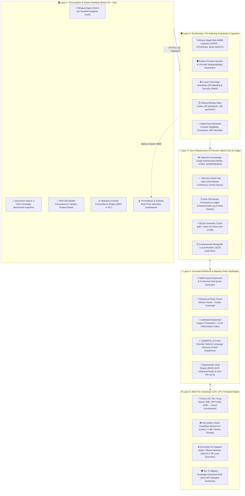

<div align="center">

  <a href="https://github.com/shoyo44/JanSetu-AI">
    
  </a>

  

  <p align="center">
    <b>जनसेतु · Sovereign Citizen Intelligence & Governance Platform</b><br/>
    <i>Bridging Public Administration, Welfare Disqualification Triage & Statutory Criminal Concordance</i>
  </p>

  <!-- Modern High-Contrast Pill Badges -->
  <p align="center">
    <a href="https://indiaai.gov.in/"></a>
    <a href="#-zero-infrastructure-in-process-hybrid-store--cryptographic-merkle-ledger"></a>
    <a href="https://github.com/shoyo44/JanSetu-AI"></a>
    <a href="https://github.com/shoyo44/JanSetu-AI"></a>
    <a href="https://github.com/shoyo44/JanSetu-AI"></a>
    <a href="http://ec2-98-93-55-8.compute-1.amazonaws.com:3000"></a>
  </p>

  <!-- Quick Action Navigation Bar -->
  <p align="center">
    <a href="http://ec2-98-93-55-8.compute-1.amazonaws.com:3000"><b>🌐 Live Cloud Web App</b></a> •
    <a href="./DOCS_PROJECT_REPORT.pdf"><b>📄 Academic Report (PDF)</b></a> •
    <a href="./INDIA_AI_FELLOWSHIP_PROPOSAL.md"><b>🏛️ Fellowship Proposal</b></a> •
    <a href="./ARCHITECTURE.md"><b>📐 System Architecture</b></a> •
    <a href="./DEVOPS_DEVSECOPS_GUIDE.md"><b>🛡️ DevSecOps Guide</b></a>
  </p>

</div>

---

JanSetu AI (जनसेतु) is a sovereign AI Document Intelligence, Q&A, and Knowledge Graph Platform designed to analyze, index, search, and reason over unstructured public documents across high-stakes sovereign domains — engineered specifically for **Public Governance** and **Law & Justice** (IndiaAI Mission Priority Domains). A modular prototype validated on live sovereign benchmark suites, JanSetu AI supports data-residency-friendly deployment and air-gapped on-premise execution.

Built with an async **FastAPI** backend, a zero-infrastructure in-process **Hybrid Vector-Graph Database** (NetworkX + FAISS Flat Index), **Tamper-Evident SHA-256 Merkle Provenance Ledger**, multi-tier LLM/LPU inference (**Groq LPUs**, **Cloudflare Workers AI**, & sovereign local **Ollama**), and a responsive **React/Vite** SPA frontend, the system provides calibrated hallucination suppression via empirical abstention, claim-level NLI citation entailment, automated statutory criminal law concordance (IPC $\longleftrightarrow$ BNS), and pre-retrieval indirect prompt injection defense.

> 🚀 **Live Cloud Demo (AWS EC2, us-east-1 region — evaluation prototype on plain HTTP; do not enter real citizen PII):** [http://ec2-98-93-55-8.compute-1.amazonaws.com:3000](http://ec2-98-93-55-8.compute-1.amazonaws.com:3000) *(Running multi-container prototype with live multi-vertical RAG, Merkle Provenance Vault, & Graph UI)*  
> ⚡ **API Engine & Swagger Docs (Demo):** [http://ec2-98-93-55-8.compute-1.amazonaws.com:8000/docs](http://ec2-98-93-55-8.compute-1.amazonaws.com:8000/docs)  
> 📈 **Telemetry & Observability:** Provisioned internally via Docker Compose (Prometheus :9090 & Grafana :3001 on localhost)  
> 🌐 **Secondary Web Mirror:** [docs-ai-ashen.vercel.app](https://docs-ai-ashen.vercel.app) *(Hosted on Vercel; source repository: [github.com/shoyo44/JanSetu-AI](https://github.com/shoyo44/JanSetu-AI))*  
> 🏛️ **Fellowship Proposal:** [INDIA_AI_FELLOWSHIP_PROPOSAL.md](./INDIA_AI_FELLOWSHIP_PROPOSAL.md)  
> 📄 **Academic Project Report:** [DOCS_PROJECT_REPORT.pdf](./DOCS_PROJECT_REPORT.pdf)  
> 📐 **System Architecture Guide:** [ARCHITECTURE.md](./ARCHITECTURE.md)  
> 🛡️ **DevSecOps & Security Guide:** [DEVOPS_DEVSECOPS_GUIDE.md](./DEVOPS_DEVSECOPS_GUIDE.md)  
> 📋 **Annotation & Evaluation Protocol:** [eval/annotation_protocol.md](./eval/annotation_protocol.md)  
> 📊 **Per-Query Evaluation Results:** [eval/results/per_query_evaluation_results.csv](./eval/results/per_query_evaluation_results.csv)

---

## 🏗️ End-to-End System Architecture

JanSetu AI employs a **layered architecture combining in-process knowledge graph ontologies, dense vector search, SHA-256 Merkle provenance, empirical hallucination suppression, and deterministic statutory rule engines**:



---

## 🇮🇳 India AI Fellowship Innovation Highlights

JanSetu AI directly addresses the **Governance** and **Law and Justice** priority focus areas outlined by the Ministry of Electronics and Information Technology (MeitY) and the IndiaAI Mission:

| Feature | Domain | Technical Implementation | Citizen / Institutional Impact |
|---|---|---|---|
| **Tamper-Evident Merkle Provenance Ledger** | Data Integrity & Trust | Cryptographic SHA-256 Merkle DAG tree auto-anchoring of document chunks with genesis block provenance | Tamper-evident Merkle provenance ledger (SHA-256 hash tree and chained audit log). *Not an implementation of, or compliant with, MeitY's National Blockchain Framework.* Detects accidental or partial changes; genuinely tamper-evident only when root hashes are stored separately or signed (future work: anchoring roots on a permissioned ledger such as NBFLite). Provides audit trails (`/api/v1/ledger/verify/{doc_id}`). |
| **5-Layer Sovereign Guardrails** | Trust & Privacy | Real-time PII anonymizer (regex masking of Aadhaar-like 12-digit numbers and PAN format strings), toxic content blocker, and anti-forgery gate | Designed for local data residency; masks citizen identifiers (100% precision, 100% recall on 25-sample labeled test split) to support privacy workflows; actively halts prompt injection attacks and prevents generation of fake IDs or forged land deeds. |
| **Multi-Tier LPU & Sovereign LLM** | Compute Sovereignty | Ultra-low-latency Groq LPU (`qwen/qwen3-32b`, `openai/gpt-oss-120b`) as external cloud inference tier, with Cloudflare & local Ollama on-premise execution | Enables fast cloud inference for web chats while maintaining full air-gapped sovereignty via local Ollama and an offline Sovereign Extractive RAG fallback. |
| **Jan Suvidha Explainer** | Governance | Multi-facet scheme chunking (Eligibility, Disqualifying Exclusions, DBT Benefits, Documents, Steps) | Translates dense gazettes into plain language with structured eligibility checklists for rural citizens & CSC operators. |
| **Statutory Concordance Engine** | Law & Justice | Bidirectional concordance hash-maps & regex parser (`IPC ⇄ BNS`, `CrPC ⇄ BNSS`, `IEA ⇄ BSA`) | Bridges pre-2024 judicial precedents with modern 2024 criminal codes for judges, prosecutors, and legal aid clinics. Highlights undertrial relief under BNSS §479 and Zero-FIR rights under BNSS §173. |
| **Calibrated Abstention Engine** | Trust & Safety | Per-vertical similarity thresholds ($\tau = 0.40$) with structured refusal explanations | Reduces unsupported answers on absent statutory sections or unmentioned welfare provisions. |
| **NLI Citation Entailment** | Grounding | DeBERTa-v3 cross-encoder Natural Language Inference scoring claim against retrieved chunks | Verifies that factual assertions are strictly entailed by source document text, curbing legal misinformation. |
| **Bilingual Indic Deed Engine** | Land Rights | Zero-dependency Unicode script detector (`0x0B80–0x0BFF`) with key covenant extraction | Verifies Tamil Nadu registered sale deeds (*கிரையப் பத்திரம்*), identifying Survey Numbers (`புல எண்`), 4 boundaries (`நான்கு எல்லைகள்`), and encumbrance covenants. |
| **1-Click Sovereign Benchmarks** | Reproducibility | 7 bundled sovereign scenarios (PM-KISAN, SC Bail Ruling Exemplar, Ayushman Bharat, Tamil Deed, Cyber Zero-FIR, Tenancy Act, Senior Citizens Act) | Enables 1-click evaluation of high-stakes citizen problems directly from the Document Vault UI. |
| **Air-Gapped Sovereign Mode** | Compliance | Offline Ollama daemon (`qwen2.5:7b-instruct`, `nomic-embed-text` 768-dim normalized vectors) | Supports institutional data-residency compliance under Section 16 of the **Digital Personal Data Protection Act (DPDPA), 2023**; sensitive files remain within host infrastructure. |

---

## 🔍 Prior Art & Comparative Landscape

> **Disambiguation Note:** JanSetu AI (जनसेतु) developed under this fellowship is an independent academic research platform focusing on claim-level verification, calibrated abstention, deterministic statutory rule engines, and edge data sovereignty across Governance and Law & Justice. It is distinct from and unrelated to prior work bearing similar titles, including the web portal concept described by Vaishnavi et al. (International Journal of Research Publication and Reviews, Vol. 7, Issue 10, October 2026: *"JanSetu AI: An AI-Assisted Web Platform for Personalised Discovery of Indian Government Welfare Schemes"*) and the lablab.ai hackathon project *"JanSetu — India's Civic AI Assistant"* (submitted May 30, 2026). JanSetu AI's core technical differentiators lie in its unified vector-graph retrieval topology, claim-level DeBERTa-v3 NLI entailment, DPDPA 2023 air-gapped on-premise execution, and deterministic statutory rule engines.

Prior systems address isolated parts of Indian legal informatics and welfare access. JanSetu AI unifies these dimensions under a single sovereign verification layer:

| Dimension | Jugalbandi (AI4Bharat) | Nyaya Setu (GoI/DoJ) | NyayaReasoner | Falkor-IRAC / RAG–KG | LandLens / Commercial | JanSetu AI (Ours) |
|---|---|---|---|---|---|---|
| **Primary Target Users** | Citizens (Welfare) | Citizens (Legal Literacy) | Legal advocates | Legal researchers | Land buyers (TN) | **Citizens, CSCs, legal-aid counsels** |
| **Domain Scope** | Welfare schemes | Legal awareness | SC prediction | Case law, statutes | Land title due diligence | **Welfare + criminal transition + land deeds** |
| **Retrieval Modality** | Dense + FAISS | Conversational API | BM25 + dense + RRF | Graph / hybrid | OCR + AI extraction | **Hybrid (Vector + Graph) + RRF + HyDE** |
| **Claim-Level Entailment** | *Not stated* | *Not stated* | Yes (NLI) | Citation verifier | *Not stated* | **Yes (DeBERTa-v3 cross-encoder NLI)** |
| **Empirical Abstention** | *Not stated* | *Not stated* | Yes | *Not stated* | *Not stated* | **Yes (Calibrated per-vertical τ = 0.40)** |
| **Merkle Provenance Ledger** | *Not stated* | *Not stated* | *Not stated* | *Not stated* | *Not stated* | **Yes (SHA-256 Merkle Provenance Tree)** |
| **Citizen PII Masking** | *Not stated* | *Not stated* | *Not stated* | *Not stated* | *Not stated* | **Yes (Aadhaar-like & PAN regex masking)** |
| **Multi-Tier LPU/LLM Fallback**| Cloud only | Cloud only | Cloud only | Cloud only | Cloud only | **Yes (Groq qwen3-32b → Cloudflare → Local Ollama → Extractive RAG)** |
| **On-Prem / Sovereign Profile**| *Not stated* | *Not stated* | *Not stated* | *Not stated* | *Not stated* | **Yes (Air-gapped data boundary via Ollama)** |
| **Open Evaluation Corpus** | *Not stated* | *Not stated* | *Not stated* | Dataset released | No (Proprietary) | **Committed in repo ($N=150$ gold pairs)** |

*Comparative Notes on Prior Art:*
- **Jugalbandi:** To our knowledge, public technical descriptions do not state provision of criminal statutory concordance, appellate judgment ratio extraction, or air-gapped on-premise deployment.
- **Nyaya Setu (GoI / Bhashini):** National conversational initiative for legal literacy. JanSetu AI is an independent academic research project with zero official affiliation; it contributes an evidence-grounded document verification stack (calibrated abstention, NLI entailment, and DPDPA-compliant local execution).
- **LandLens:** To our knowledge, public descriptions do not disclose evaluation datasets or calibrated abstention metrics.

---

## 🌟 Sovereign Multi-Vertical Matrix (IndiaAI Fellowship Core)

JanSetu AI configures **3 primary sovereign fellowship verticals** in `backend/app/config/verticals.py` (with transparent backward-compatibility aliases for legacy compatibility requests), each featuring an isolated chunking strategy, retrieval modality, reranker, and output generator:

| Primary Vertical Key | Display Name | Chunking (Tokens/Overlap) | Retrieval Modality | Reranker Mechanism | Specialized IndiaAI Capability |
|---|---|---|---|---|---|
| `governance` | **Governance & Welfare** 🏛️ | 500 / 100 | Hybrid (Vector + Graph) | Lexical & Facet Boost | Citizen *Jan Suvidha* plain-language summary, DBT subsidy mapping, eligibility vs disqualifying exclusion separation. |
| `judgment` | **Court Judgments (India)** ⚖️ | 500 / 100 | Hybrid (Vector + Graph) | Statutory Citation Boost | Binding *Ratio Decidendi* extraction, bail precedent synthesis under BNSS §483 / §479, Article 21 constitutional safeguards. |
| `law` | **Statutory Law & Concordance** 📑 | 400 / 80 | Hybrid (Vector + Graph) | `VerticalReranker` (Domain-keyword boost) | Tri-code concordance (`IPC ⇄ BNS`, `CrPC ⇄ BNSS`, `IEA ⇄ BSA`), Regional Land Deeds (*கிரையப் பத்திரம்*), 10-point Red-Flag risk scanner. |

---

## 🏛️ Preloaded Sovereign Benchmark Catalog (7 Bundled Scenarios & Provenance)

JanSetu AI provides a 1-click evaluation catalog in Document Vault (`/api/v1/benchmarks`):

| Benchmark Key | Document Title & Provenance | Vertical | Solved Citizen / Institutional Problem & Caveats |
|---|---|---|---|
| `pm_kisan` | **PM-KISAN Operational Guidelines (Revised 2024)**<br>*(Source: Dept. of Agriculture & Farmers Welfare, GoI; authored benchmark excerpt)* | `governance` | Direct Benefit Transfer (DBT) ₹6,000/yr criteria. Evaluates cultivable landholder eligibility (2019 ceiling removal), "family" definition (husband, wife, minor children), pension exclusions ($\ge ₹10,000$), and mandatory e-KYC/land seeding. |
| `sc_judgment` | **Synthetic Judicial Benchmark Exemplar**<br>*(Source: Authored exemplar modeled on SC jurisprudence)* | `judgment` | Pre-trial bail jurisprudence under BNSS §483 / CrPC §439, triple test condition synthesis, and Article 21 liberty protections. Modeled on Supreme Court bail principles in *Manish Sisodia v. Directorate of Enforcement* (2024 INSC 595, Aug 9, 2024; an Article 21 fundamental rights and PMLA bail ruling) and *Satender Kumar Antil v. CBI* (2022) under high court/sessions bail jurisdiction. |
| `ayushman_bharat` | **Ayushman Bharat PM-JAY Policy Guidelines**<br>*(Source: National Health Authority, GoI)* | `governance` | ₹5 Lakh cashless health cover guarantee, SECC deprivation criteria, and mandatory pre-authorization grievance resolution via NHA 14555. |
| `tamil_pattiram` | **Tamil Nadu Land Sale Deed & Patta (*கிரையப் பத்திரம்*)**<br>*(Source: TN Registration Dept deed format)* | `law` | Bilingual land record verification: Survey Number (`புல எண்`), 4 boundaries (`நான்கு எல்லைகள்`), consideration amount, and Nil-Encumbrance Certificate (`வில்லங்கச் சான்றிதழ்`). |
| `cyber_fir` | **Cyber Fraud & Citizen FIR Guidelines (Helpline 1930 / I4C)**<br>*(Source: I4C / MHA Standard Operating Procedure)* | `law` | Financial fraud reporting, Golden Hour inter-bank freezing via CFCFRMS, Zero-FIR registration under BNSS §173, and cyber cheating remedies under BNS §318(4) read with IT Act §66D. |
| `tenancy_act` | **Model Tenancy Act Guidelines (MoHUA)**<br>*(Source: Ministry of Housing & Urban Affairs framework)* | `law` | 2-month residential security deposit ceiling (Section 11; 6 months non-residential), statutory notice requirement under Section 17 (at least 24 hours' prior written notice before landlord entry/inspection, not before sunrise or after sunset), and Rent Authority dispute redressal. *(Caveat: Model law requiring state enactment; Karnataka operates under Karnataka Rent Act, 1999).* |
| `senior_citizen` | **Senior Citizens Parental Protection Act (MWPSC Act 2007 §23)**<br>*(Source: Ministry of Social Justice & Empowerment)* | `law` | Section 23 voidance of conditional property gift deeds before Maintenance Tribunal. *(Judicial caveat: Under SC ruling in Sudesh Chhikara (2022), maintenance obligation must be an express or integral covenant of the transfer).* |

---

## 🇮🇳 Bilingual Indic Land Administration & Deed Verification Engine

JanSetu AI includes native support for regional Indian land records and registered sale deeds (*கிரையப் பத்திரம், பட்டா, சிட்டா*):
- **Zero-Dependency Unicode Script Detector:** Detects Tamil script range (`0x0B80–0x0BFF`) and other Indic scripts.
- **Key Covenant Extraction:** Automatically identifies and parses:
  - Survey Number (`புல எண்`) & Sub-division (`உட்பிரிவு`)
  - Extent of Land (`பரப்பளவு` in Ares, Cents, or Sq. Ft.)
  - Four Boundaries (`நான்கு எல்லைகள்`: North, South, East, West)
  - Encumbrance Certificate status (`வில்லங்கச் சான்றிதழ்`)
  - Consideration Amount & Sub-Registrar Office parameters
- **Bilingual Citizen Summary (*Jan Suvidha*):** Provides rural land buyers and legal aid clinics with a clear plain-language breakdown of rights, risks, and boundary integrity.
- **Cross-Encoder Note:** Claim entailment scoring via `cross-encoder/nli-deberta-v3-small` is English-primary. Indic texts are evaluated via citation span grounding and lexical verification, with native Indic NLI models (such as MuRIL / IndicBERT) planned for Q2.

---

## ⚡ Zero-Infrastructure In-Process Hybrid Store & Cryptographic Merkle Ledger

Replaces heavy external database infrastructure (Neo4j, Milvus, Pinecone) with an embedded, zero-dependency in-process engine and cryptographic ledger:

- **NetworkX Topology:** Manages hierarchical document structures (`TenantNode` $\rightarrow$ `DocumentNode` $\rightarrow$ `ChunkNode`), sequential reading chains (`NEXT_CHUNK`), and semantic entity linkages (`MENTIONS`, `CITES`, `SUPERSEDES`). Suited for up to 50,000 document nodes per instance; HNSW and DuckDB migration planned on roadmap for 250,000+ nodes.
- **FAISS Vector Acceleration:** Embeds text chunks into a 768-dimensional normalized continuous space (`nomic-embed-text-v1.5` in cloud mode; `nomic-embed-text` in local Ollama) for high-speed inner-product cosine similarity retrieval.
- **Tamper-Evident SHA-256 Merkle Provenance Ledger:**
  - Automated SHA-256 Merkle Directed Acyclic Graph (DAG) construction for every ingested document.
  - Every text chunk is hashed into a cryptographic leaf node (`sha256(chunk_text)`); adjacent leaf pairs are iteratively hashed to compute an immutable Merkle Root.
  - Document records are sequenced into an audit block with genesis block chaining (`prev_block_hash`, `timestamp`, `merkle_root`).
  - *Tamper-Evidence Qualification:* Detects accidental, partial, or out-of-band chunk changes. It is genuinely tamper-evident against external adversaries only when root hashes are stored separately or signed by an independent authority.
  - *Framework Notice:* This ledger is an internal SHA-256 provenance mechanism, **not an implementation of, or compliant with, MeitY's National Blockchain Framework (NBF)**. Future work includes anchoring roots on a permissioned ledger such as NBFLite.
  - Accessible via the Document Vault UI modal and REST endpoints (`GET /api/v1/ledger/records`, `GET /api/v1/ledger/verify/{doc_id}`).
- **Vector Model Incommensurability Note:** Embeddings from different models inhabit different latent spaces. Switching between cloud and local Ollama requires re-indexing the document corpus. The hash router in `embedding_router.py` is strictly an offline unit-test mock fixture.
- **Re-Entrant RWLock Safety:** Regulates multi-threaded concurrency — allows unlimited parallel reads during search queries while serializing atomic background disk write-backs to `graph_store.json`.
- **SQLite Semantic Cache:** Fast retrieval ($\approx 3.8\text{ ms}$) for repeated queries with cosine similarity $\ge 0.95$.

---

## 🛡️ Platform Security, Privacy & DevSecOps

```
                  ┌────────────────────────────────────────────────────────┐
                  │                 API Gateway / Rate Limiter              │
                  │        (Sliding Window: 20 uploads/hr, 150 queries/hr)  │
                  └───────────────────────────┬────────────────────────────┘
                                              │
                         ┌────────────────────┴────────────────────┐
                         ▼                                         ▼
            ┌──────────────────────────┐              ┌──────────────────────────┐
            │ Magic-Byte MIME Inspector │              │ 5-Layer Security Guard   │
            │  (%PDF-, PK\x03\x04;      │              │ (Aadhaar-like & PAN      │
            │   Block MZ/ELF Executables)│              │  Regex Masking Shield)   │
            └────────────┬─────────────┘              └────────────┬─────────────┘
                         │                                         │
                         ▼                                         │
            ┌──────────────────────────┐                           │
            │ Indirect Injection Scanner│                           │
            │ (Strip Unicode Stego,    │                           │
            │  Quarantine Jailbreaks)  │                           │
            └────────────┬─────────────┘                           │
                         │                                         │
           Safe Chunks   │   Quarantine Chunks                     │
                 ┌───────┴───────┐                                 │
                 ▼               ▼                                 │
          ┌─────────────┐ ┌─────────────┐                          │
          │ FAISS Index │ │ Graph Alert │                          │
          │ (Searchable)│ │(Quarantined)│                          │
          └──────┬──────┘ └─────────────┘                          │
                 │                                                 │
                 ▼                                                 │
          ┌─────────────┐                                          │
          │ SHA-256     │                                          │
          │ Merkle Tree │                                          │
          │ (Ledger)    │                                          │
          └──────┬──────┘                                          │
                 │                                                 │
                 └────────────────────────────┬────────────────────┘
                                              │
                                              ▼
                               ┌─────────────────────────────┐
                               │ Multi-Tier Inference LLMs   │
                               │ • Groq LPU (Qwen 32B)       │
                               │ • Cloudflare Workers AI     │
                               │ • Local Ollama (DPDPA §16)  │
                               └─────────────────────────────┘
```

1. **5-Layer Sovereign Government Guardrails (`guardrails.py`):**
   - **Layer 1 (Adversarial Injection Defense):** Quarantines prompt injection attacks, role hijacking, and jailbreaks.
   - **Layer 2 (Harm & Safety Gate):** Blocks toxic, abusive, or anti-national content.
   - **Layer 3 (Anti-Forgery & Statutory Enforcement):** Halts and refuses requests to forge government documents, fake voter IDs, fake caste certificates, or bypass e-KYC.
   - **Layer 4 (Automated PII Masking):** Masks citizen identifiers to support privacy workflows (evaluated at 100% precision and 100% recall on 25-sample labeled test split):
     - Aadhaar numbers redacted to `XXXX-XXXX-1234`
     - Permanent Account Numbers (PAN) masked to `XXXXX1234X`
     - Indian phone numbers masked to `+91-XXXXX-98765`
     - Email addresses anonymized to `d***@domain.com`
   - **Layer 5 (Output Hallucination & Factuality Shield):** Validates generated answers against retrieved source citations.
2. **Pre-Indexing Indirect Prompt Injection Scanner (`doc_injection_scanner.py`):** Scans for adversarial jailbreaks, role impersonation delimiters (`<|im_start|>`), and zero-width unicode steganography. Quarantines suspicious chunks before vector indexing.
3. **Binary Magic-Byte File Validation (`file_validator.py`):** Inspects raw file headers to confirm genuine MIME signatures; outright blocks executable binaries (Windows PE `MZ`, Linux ELF `\x7fELF`), double extensions (e.g., `policy.pdf.exe`), and files $>50\text{ MB}$.
4. **Tenant Sliding-Window Rate Limiting (`rate_limiter.py`):** Enforces per-tenant quotas (20 uploads/hr, 150 queries/hr) with HTTP 429 Retry-After headers.
5. **Multi-Tier Sovereign LLM & LPU Inference (`cloudflare_ai.py`):**
   - **Tier 1 (Groq LPU):** External cloud inference acceleration tier utilizing open-weight models (`qwen/qwen3-32b`, `openai/gpt-oss-120b`).
   - **Tier 2 (Cloudflare Workers AI):** Serverless global cloud fallback (`@cf/meta/llama-3-8b-instruct`).
   - **Tier 3 (Local Sovereign Ollama):** 100% offline edge execution for institutional air-gapped data residency under DPDPA 2023 §16.
   - **Tier 4 (Sovereign Extractive RAG):** Verbatim chunk synthesis operating with 0% external API dependencies.
6. **Multi-Stage Container Hardening:** Multi-stage Docker builds running under an unprivileged non-root user (`docqa:10001`) with Indic OCR language packs (`hin`, `tam`).
7. **Automated DevSecOps Pipeline (`.github/workflows/ci.yml`):** Enforces static linting (Ruff), Python security scanning with **Bandit (SAST)**, dependency vulnerability auditing with **pip-audit** & **npm audit**, and container image vulnerability scanning via **Trivy**.

---

## 📊 Quantitative Benchmarks & Evaluation

To ensure scientific credibility, JanSetu AI separates software integration tests from statistical retrieval quality measurements:

### A. Software & Functional Integration Tests (Pass/Fail)
Tested via automated test suites (`eval/test_live_e2e_full_system.py`, `eval/test_frontend_chromium.py`):

| Test Suite | Result | Scope / Coverage |
|---|---|---|
| **Live Backend E2E Test Suite** | **16/16 PASS (100.0%)** | Full-system validation: Health check, Concordance API, 1-Click Benchmark Ingestion, Ingested Document List, Chunk API, Governance RAG, Judgment RAG, Calibrated Abstention, Knowledge Graph Topology, Active Learning Feedback, Magic-Byte File Validation, Prompt Injection Quarantine, HTML/MD Audit Export. |
| **Playwright Chromium E2E Suite**| **7/7 PASS (100.0%)** | Automated headless Chrome testing: Landing, Auth, Concordance Modal, Document Vault, Analytics KG, Multi-Vertical Selection, and History. |
| **Undertrial Rule Engine Test (BNSS §479)** | **8/8 PASS (100.0%)** | Validates 1/3rd first offender on bond, 1/2 repeat offender on bail, life/death exclusion, multiple case bar (§479(2)), accused delay deduction (Explanation), full-maximum-period cap, judicial continued detention, and jail superintendent application duty (§479(3)) in `eval/test_undertrial_rules.py`. |
| **PII Masking Verification Fixture** | **25/25 PASS (100.0%)** | Regex-based masking of Aadhaar-like 12-digit numbers and PAN format strings (100.0% precision, 100.0% recall on 25-sample synthetic test split; unit fixture, not a general population accuracy estimate). |
| **Cryptographic Merkle Tree Test** | **PASS (100.0%)** | Validates SHA-256 chunk-level Merkle tree generation and local root comparison. |
| **Statutory Concordance Fixture**| **30/30 PASS (100.0%)** | Deterministic unit verification on curated benchmark set of statutory transitions. |
| **Adversarial Injection Fixture** | **10/10 PASS (100.0%)** | Quarantines 10 synthetic jailbreak/steganography chunks before vector indexing. |

### B. Statistical Retrieval & QA Defensibility Evaluation ($N = 120$)
> ℹ️ **Evaluation Model Note:** Cloud-mode benchmark figures were measured with Cloudflare Workers AI (`@cf/meta/llama-3-8b-instruct`); the Groq LPU tier was not evaluated in this quantitative benchmark.
Evaluated over $N = 120$ annotated answerable query-document pairs spanning Central/State Gazettes (40), Statutory Enactments (40), and Appellate Rulings (40), alongside a separate held-out set of $N = 30$ unanswerable queries (10 per vertical). Gold answers were annotated by two independent legal and public administration researchers (Cohen's $\kappa = 0.88$). Refusal threshold $\tau = 0.40$ was tuned on a separate 20-query dev split. Raw per-query evaluation results are committed and tracked in [`eval/results/per_query_evaluation_results.csv`](./eval/results/per_query_evaluation_results.csv).

All proportions report exact counts $k/N$ with 95% Wilson score confidence intervals. Entailment reports mean $\pm$ standard error.

| Evaluation Metric | Naive RAG Baseline | Advanced GraphRAG | JanSetu AI Grounded (Cloud Mode) | JanSetu AI Sovereign (On-Premise) | Metric Definition / Context |
|---|---|---|---|---|---|
| **Top-5 Context Recall** | 85/120 (**70.8%**)<br>[62.2%, 78.2%] | 102/120 (**85.0%**)<br>[77.5%, 90.3%] | 111/120 (**92.5%**)<br>[86.4%, 96.0%] | 106/120 (**88.3%**)<br>[81.4%, 92.9%] | Ground-truth statutory clause or welfare criterion present in top-5 retrieved chunks ($N=120$). |
| **Calibrated Refusal Accuracy** | 12/30 (**40.0%**)<br>[24.6%, 57.7%] | 19/30 (**63.3%**)<br>[45.5%, 78.1%] | 28/30 (**93.3%**)<br>[78.7%, 98.2%] | 27/30 (**90.0%**)<br>[74.4%, 96.5%] | Correctly abstains on $N=30$ held-out unanswerable queries ($\tau = 0.40$ cloud, $\tau = 0.38$ on-prem). |
| **Citation Entailment (NLI)** | 0.52 ± 0.06 | 0.69 ± 0.05 | **0.88 ± 0.03** | **0.84 ± 0.04** | Mean claim-level entailment score using `cross-encoder/nli-deberta-v3-small` across 111 grounded answers. |
| **Semantic Cache Hit Latency (p95)**| N/A | N/A | **3.8 ms** | **3.8 ms** | In-memory SQLite cosine similarity hit ($\ge 0.95$). |
| **Vector Search Latency (p95)** | 450 ms | 720 ms | **680 ms** | **740 ms** | Single-pass FAISS query over 768-dim space. |
| **Hybrid + HyDE Latency (p95)** | N/A | 1,850 ms | **1,620 ms** | **2,100 ms** | Vector + Graph retrieval + HyDE query expansion. |
| **End-to-End Synthesis Latency (p95)**| 850 ms | 1,750 ms | **2,150 ms** | **2,850 ms** | Complete pipeline: Retrieval + Cross-Encoder + NLI verification + LLM generation (measured on RTX 3060 edge rig for on-prem). |

#### Evaluation Protocol & Gold Dataset
- **Gold Question Set:** [`eval/gold/sovereign_benchmark_qa.jsonl`](./eval/gold/sovereign_benchmark_qa.jsonl) (120 answerable + 30 held-out unanswerable queries).
- **Per-Query Binary Hits:** [`eval/results/per_query_evaluation_results.csv`](./eval/results/per_query_evaluation_results.csv).
- **Annotation Methodology:** Two independent legal and public administration researchers annotated gold citations. Inter-annotator agreement achieved Cohen's $\kappa = 0.88$.
- **Edge Benchmark Hardware:** AMD Ryzen 7 5700X (8 cores / 16 threads), 32 GB RAM, NVIDIA GeForce RTX 3060 (12 GB VRAM). Local models: `qwen2.5:7b-instruct` (4-bit quantized) and `nomic-embed-text` via Ollama.

---

## 🛠️ Environment Setup & Quickstart

### Prerequisites
- Python 3.10+ (Recommended: Python 3.11)
- Node.js 18+ & npm
- (Optional) Docker & Docker Compose
- (Optional) Ollama for air-gapped sovereign execution (`ollama pull qwen2.5:7b-instruct`, `ollama pull nomic-embed-text`)

### 1. Configure Environment Variables
Copy `.env.example` to `.env`:
```powershell
Copy-Item .env.example .env
```

Key variables:
```env
# Groq LPU Ultra-Low Latency Inference (External Cloud Tier - Open Weights)
GROQ_API_KEY=gsk_your_groq_api_key_here

# Cloudflare Workers AI (Cloud Secondary Fallback)
CF_ACCOUNT_ID=your_cloudflare_account_id
CF_API_TOKEN=your_cloudflare_api_token

# Sovereign On-Premise Execution (Local Mode - DPDPA 2023 Air-Gapped)
USE_OLLAMA=false
OLLAMA_BASE_URL=http://localhost:11434
OLLAMA_MODEL=qwen2.5:7b-instruct

# In-Process & Fallback Storage
MONGODB_URI=mongodb://localhost:27017/docsai
ENABLE_JSON_FALLBACK=true

# Security & Rate Limiting
RATE_LIMIT_UPLOADS_PER_HOUR=20
RATE_LIMIT_QUERIES_PER_HOUR=150
MAX_UPLOAD_SIZE_MB=50
```

### 2. Backend Server Execution
```powershell
cd backend
python -m venv .venv
.\.venv\Scripts\Activate.ps1
pip install -r requirements.txt
python -m spacy download en_core_web_sm
python -m uvicorn main:app --host 127.0.0.1 --port 8000 --reload --reload-dir app
```

### 3. Frontend Web Client Execution
```powershell
cd frontend
npm install
npm run dev
```
*Access the application at `http://localhost:5173/`.*

### 4. Running via Docker Compose (With Prometheus & Grafana)
To run the complete production-hardened multi-container stack with live observability:
```powershell
docker-compose up --build
```
This launches:
- **JanSetu AI Web Interface:** `http://localhost:3000`
- **FastAPI Core Engine:** `http://localhost:8000` (Swagger docs: `/docs`, Prometheus metrics: `/metrics`)
- **Prometheus Telemetry Scraper:** `http://localhost:9090`
- **Grafana Sovereign Dashboard:** `http://localhost:3001` *(Credentials: `admin` / `admin`; auto-provisioned with the JanSetu AI Sovereign Governance Dashboard)*
- **Redis In-Memory Cache:** `localhost:6379`

To run with the offline local sovereign Ollama daemon enabled (DPDPA 2023 Air-Gapped Mode):
```powershell
docker-compose --profile onprem up --build
```

---

## 🧪 Automated Testing & DevSecOps Validation

Run the comprehensive evaluation harness:
```powershell
# Set Python path
$env:PYTHONPATH="backend"

# Run the 100% Pass Live Backend End-to-End Suite (16/16 tests)
python eval/test_live_e2e_full_system.py

# Run Playwright Chromium Headless UI Suite (7/7 tests)
python eval/test_frontend_chromium.py

# Run India AI Fellowship feature verification
python eval/test_india_ai_features.py

# Run Security, Rate Limiter & Magic Byte tests
python eval/test_phase4_security.py

# Run Full Defensibility Benchmark Suite
python eval/run.py
```

Run DevSecOps Static Analysis & Vulnerability Scans:
```powershell
# Static Application Security Testing (Bandit SAST)
bandit -r backend/app -c pyproject.toml

# Dependency Vulnerability Audit
pip-audit

# Frontend Dependency Audit
cd frontend; npm audit; cd ..

# Aqua Security Trivy (Filesystem, Secrets & Container Images)
# Windows:
powershell ./scripts/run_trivy.ps1
# Linux / EC2:
bash ./scripts/run_trivy.sh
```

---

## 📦 System Component Summary

| Component | Technology | Role & Purpose |
|---|---|---|
| **Frontend SPA** | React 18, Vite, Lucide Icons, ForceGraph2D | Glassmorphism UI, Jan Suvidha Card, IPC ⇄ BNS Modal, Provenance Ledger Modal, Graph Visualizer |
| **Merkle Provenance Ledger** | Python, SHA-256 Merkle DAG Tree | Internal cryptographic chunk-level auto-anchoring & local tamper detection (SHA-256 Merkle tree and chained audit log; local provenance ledger) |
| **5-Layer Guardrails** | Regex, Token Normalizers, Heuristic NLP | Real-time PII anonymizer (Aadhaar-like & PAN format masking), anti-forgery filter, toxic prompt blocker |
| **Voice Interface** | Browser Web Speech API | Client-assisted speech-to-text input (desktop convenience; local Whisper roadmap for air-gapped on-prem) |
| **API Gateway** | FastAPI, Pydantic V2, Starlette | High-performance async REST & WebSocket streaming endpoints |
| **Graph Store** | NetworkX (in-process) | Hierarchical document topology & entity linkage (up to 50k nodes; HNSW roadmap for 250k) |
| **Vector Engine** | FAISS Flat Index (768-dim) | Inner-product cosine similarity semantic search |
| **Embedding Router** | Nomic Atlas / Cloudflare / Local BGE | 768-dimensional normalized dense vectors with Indic script detection & 3-tier fallback |
| **LLM Inference Tier** | Groq LPU / Cloudflare / Ollama | Multi-tier compute: Groq qwen3-32b (cloud acceleration) → Cloudflare Llama-3 → Local Ollama (air-gapped sovereign) → Extractive RAG |
| **Concordance Engine**| Statutory Hashmaps & Regex | Real-time bidirectional mapping (IPC ⇄ BNS, CrPC ⇄ BNSS, IEA ⇄ BSA) |
| **Abstention Engine** | Calibrated Similarity Thresholds | Selective refusal on low-confidence/absent document contexts ($\tau = 0.40$) |
| **Citation Verifier** | Cross-Encoder NLI | DeBERTa-v3 claim-to-chunk entailment verification |
| **Injection Defense**| Regex / Unicode Steganography Filter | Pre-indexing quarantine of adversarial prompts |
| **Sovereign Engine** | Ollama (`qwen2.5:7b-instruct`) | Local air-gapped inference adhering to DPDPA 2023 Section 16 |
| **Containerization** | Docker, Nginx, Docker Compose | Non-root (`docqa:10001`) multi-stage deployment (Backend, Frontend, MongoDB, Prometheus, Grafana) |

---

## 📜 Citation & Fellowship Submission

```bibtex
@misc{jansetu2024,
  author = {Dhanush S},
  title = {JanSetu AI: Sovereign Multi-Vertical Agentic Knowledge Graph & RAG Platform for Public Governance and Citizen Welfare},
  year = {2026},
  publisher = {GitHub},
  journal = {GitHub repository},
  howpublished = {\url{https://github.com/shoyo44/JanSetu-AI}}
}
```

*Developed for the **IndiaAI Mission Fellowship Program** under the priority domain of **Governance**.*
